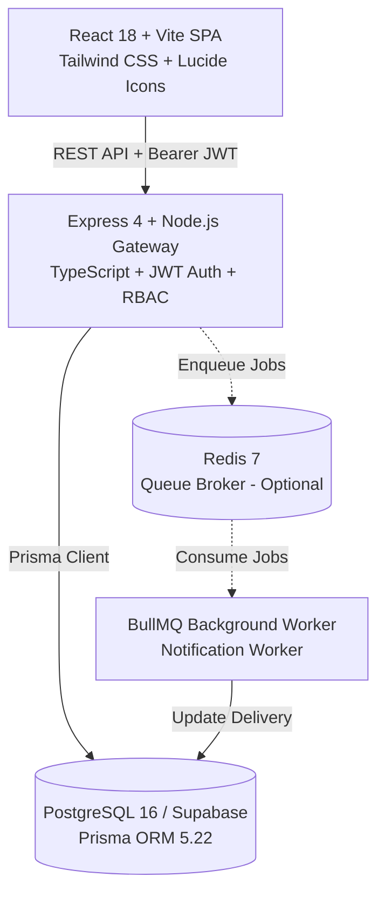
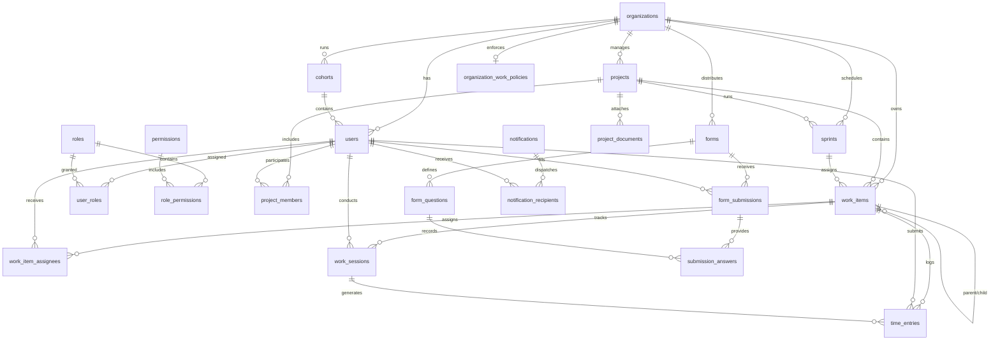

# Complete Implementation Audit for BRD Revision
**Project:** Intern Project Management and Performance Tracking Platform (Intern Hub / PRMS)  
**Audit Target:** Codebase Implementation vs. `BRD_PRMS_v2.1` (Mentor-Review Draft)  
**Audit Date:** October 9, 2026  
**Auditor:** Antigravity Autonomous Pair Programmer  
**Repository Branch Inspected:** `main` (commit baseline `2234531` + working tree) and local branch `intern-dashboard` (commit `46565eb`)

---

## 1. Executive Summary

This document provides a factual, evidence-based implementation audit of the **Intern Project Management and Performance Tracking Platform (Intern Hub)** codebase. Its primary objective is to equip the project team and mentors with an accurate account of what is actually built, tested, and operational versus what remains partially implemented, UI-only, planned, or omitted from the current working software.

### Key Audit Findings:
1. **Core Work & Project Management is Far Ahead of BRD v2.1 Scope:**
   - The platform features a **strict, Jira-style work-item hierarchy** (`EPIC` → `STORY`/`BUG` → `TASK` → `SUBTASK`, with leaf invariants for `SUBTASK` and `BUG`), verified across 30 automated backend tests.
   - Sprints, story points, burndown metrics, sprint rollover, and four synchronized project views (**Roadmap**, **Sprint Workspace**, **Backlog & Epics**, and **Kanban Board**) are fully implemented and backed by PostgreSQL via Prisma.
   - Manager personal tasks (`project_id = null`, `type = TASK`) are strictly isolated from project hierarchies.
2. **Multi-Tenancy & Super Admin Exist in Software but are Missing in BRD v2.1:**
   - Multi-tenant organization isolation (`organizations`, `organization_work_policies`), automated user provisioning, and a dedicated `SUPER_ADMIN` console exist and function in code but are absent from BRD v2.1.
3. **Discrepancy in Role Architecture:**
   - BRD v2.1 specifies six organizational roles: `Manager`, `Technical Architect`, `Capability Lead`, `Mentor`, `Tech Lead`, and `Intern`.
   - The actual implementation splits authorization into two tiers:
     - **System Roles (Global/Organization):** `SUPER_ADMIN`, `ADMIN`, `MANAGER`, `TECH_LEAD`, `EMPLOYEE`, `INTERN`. (There are no system roles for `Technical Architect`, `Capability Lead`, or `Mentor`).
     - **Project Membership Roles (`ProjectMember.project_role`):** `DEVELOPER`, `QA_TESTER`, `TECH_LEAD`, `UI_UX_DESIGNER`, `DEVOPS_ENGINEER`.
4. **Timesheet Architecture Reconciliation (Formerly Attendance):**
   - BRD v2.1 referenced attendance as a separate feature (`FR-AT-01`, `FR-AT-02`).
   - As confirmed by architectural alignment, the system operates without a separate attendance table; all time tracking is unified under **Timesheets** computed dynamically by `timesheet.service.ts` from `work_sessions` clamped to `organization_work_policies` office hours and lunch breaks.
   - Separate mentions of attendance are removed; time tracking is exclusively handled as Timesheets.
5. **Forms & FOM Integration:**
   - Backend form engine (`forms`, `form_questions`, `form_submissions`, `submission_answers`) is fully functional.
   - In the Manager UI, forms are rendered inside `TeamsChannelView.jsx` (Teams channel metaphor) and `FormsView.jsx`. Form reminder actions trigger UI toasts rather than scheduled background notifications.
6. **Performance Reports & Analytics:**
   - Manager `ReportsView.jsx` is currently an unbacked UI placeholder labeled "Planned for V2".

---

## 2. Current System Overview

The platform is designed as an organization-scoped, multi-tier enterprise web application for managing intern onboarding, project execution, time tracking, and performance evaluations.

### Application Sub-Applications / Portals:
1. **Manager Console (`/manager/*`):** Accessed by `MANAGER` role; provides organization oversight, member provisioning, project workspace, backlog/sprints, personal tasks, and teams channel.
2. **Intern Workstation (`/intern/*`):** Accessed by `INTERN` and `EMPLOYEE` roles; provides scoped project visibility, personal kanban, task start/stop work timers, form submission, and notifications.
3. **Super Admin Console (`/super-admin/*`):** Accessed by `SUPER_ADMIN` role; enables multi-tenant organization creation and license management.

---

## 3. Manager Dashboard Requirements and Status

| Feature / Capability | Implementation Status | Backend Route / Database Model | Frontend Component | Verification Evidence & Behavior |
| :--- | :--- | :--- | :--- | :--- |
| **Cohort Management & Filtering** | **Implemented** | `GET /api/cohorts` Model: `Cohort` | `Header.jsx` `ManagerDashboardView.jsx` | Tested. Cohort selector in header dynamically filters dashboard metrics and member rosters. Cohort 2 renders an empty-state preview. |
| **Dashboard Metrics (Cards)** | **Implemented** | Aggregated from `Project`, `User`, `WorkItem` | `MetricCards.jsx` `ManagerDashboardView.jsx` | Total interns, active projects, tasks completed, and overdue task count calculated live from database records. |
| **Upcoming Deadlines Widget** | **Implemented** | `GET /api/work-items` | `UpcomingDeadlines.jsx` | Categorizes non-completed tasks into `TODAY`, `THIS WEEK`, and `UPCOMING` based on ISO `due_date`. |
| **Project Health Widget** | **Implemented** | `GET /api/projects` | `ProjectHealth.jsx` | Calculates owner, member count, and progress percentages from live projects. |
| **Broadcast Alert Dispatcher** | **Implemented** | `POST /api/notifications` Model: `Notification` | `BroadcastAlert.jsx` `AlertModal.jsx` | Dispatches announcements to selected users or entire cohorts; persists records to database. |
| **Member Directory & Search** | **Implemented** | `GET /api/users` Model: `User` | `InternsView.jsx` | Live filtering by search query, status tabs, and subbatch (`A1`, `B1`, etc.). |
| **Single User Provisioning** | **Implemented** | `POST /api/users` | `AddMemberModal.jsx` `CredentialModal.jsx` | Provisions user code (`INT-xxx`), generates initial credentials, forces password change. |
| **Bulk CSV User Import** | **Implemented** | `POST /api/users/bulk/validate` `POST /api/users/bulk` | `BulkImportModal.jsx` | Validates uploaded CSV rows against organization boundaries and batch assignments before bulk commit. |
| **User Deactivation & Reset** | **Implemented** | `POST /api/users/:id/deactivate` `POST /api/users/:id/reset-password` | `DeactivateUserModal.jsx` `ResetPasswordModal.jsx` | Tested. Inactivates user login and regenerates temporary passwords. |
| **Tech Leads Oversight View** | **Implemented** | `GET /api/users?role=TECH_LEAD` | `TechLeadsView.jsx` | Renders cards of organization users holding the `TECH_LEAD` role. |
| **Project Creation & Editing** | **Implemented** | `POST /api/projects` `PATCH /api/projects/:id` | `ProjectsDirectoryView.jsx` `CreateProjectModal.jsx` | Creates projects with owner, organization scoping, and date boundaries. |
| **Project Member Roles Assignment** | **Implemented** | `PATCH /api/projects/:id/members/roles` | `AssignProjectRolesModal.jsx` `ProjectOverviewTab.jsx` | Assigns project-level roles (`DEVELOPER`, `QA_TESTER`, `TECH_LEAD`, `UI_UX_DESIGNER`, `DEVOPS_ENGINEER`). |
| **Project Document Management** | **Implemented** | `POST /api/projects/:id/documents` `GET /api/projects/:id/documents` | `ProjectFilesSection.jsx` `FilePreviewModal.jsx` | Uploads, previews, downloads, and deletes project documents via `storage.service.ts`. |
| **Jira-Style Strict Hierarchy Backlog** | **Implemented** | `POST /api/work-items` `GET /api/work-items` | `ProjectBacklogTab.jsx` `HierarchicalIssueTable.jsx` | Strict tree: `EPIC` → `STORY`/`BUG` → `TASK` → `SUBTASK`. Story points, inline expandable children, context creation. |
| **Sprint Lifecycle & Workspace** | **Implemented** | `POST /api/projects/:id/sprints` `POST /.../sprints/:id/start` `POST /.../sprints/:id/complete` | `ProjectSprintWorkspaceTab.jsx` `CompleteSprintModal.jsx` | Sprints created, started (single active invariant), and completed with incomplete issue rollover. |
| **Interactive Kanban Board** | **Implemented** | `PATCH /api/work-items/:id` | `KanbanBoard.jsx` `TaskCard.jsx` | Swimlanes for To Do, In Progress, In Review, Completed. Status drag/update connected to API. |
| **Roadmap Timeline View** | **Implemented** | `GET /api/work-items` | `ProjectRoadmapTab.jsx` | Renders epics, direct-child progress bars, dates, and status summaries. |
| **Action Items (formerly MoM)** | **Implemented (Database-Backed)** | Dedicated table `action_items` in PostgreSQL | `ProjectMomTab.jsx` | Dedicated database table (`action_items`) with status, priority, due date, assignee, and project foreign keys. |
| **Manager Personal Tasks** | **Implemented** | `GET /api/work-items?my_personal=true` | `ManagerMyTasksView.jsx` | Personal work items (`project_id = null`, `type = TASK`) strictly isolated from project hierarchies. |
| **Forms Builder & Submissions** | **Implemented** | `POST /api/forms` `GET /api/forms/:id/submissions` | `TeamsChannelView.jsx` `FormBuilderDrawer.jsx` `ViewSubmissionsDrawer.jsx` | Full question builder (7 question types), publication workflow, and live response viewer. |
| **Performance Reports View** | **UI Only** | N/A | `ReportsView.jsx` | Static placeholder stating "Planned for V2". |
| **Timesheet & Work-Session Audit** | **Implemented** | `GET /api/timesheet/manager-report` `GET /api/timesheet/organization-policy` | `TimesheetView.jsx` | Daily/weekly timesheet summaries, timesheet minutes clamped to office hours, net work calculations. |

---

## 4. Intern Dashboard Requirements and Status

| Feature / Capability | Implementation Status | Backend Route / Service | Frontend Component | Verification Evidence & Behavior |
| :--- | :--- | :--- | :--- | :--- |
| **Role-Specific Authentication & Routing** | **Implemented** | `/login`, `/intern/*` `ProtectedRoute` | `App.jsx` `InternApp.jsx` | Intern login verified; redirects to `/intern/dashboard`; prevents non-intern access. |
| **Dashboard Overview Tab** | **Implemented** | Live work items + user stats | `InternDashboardTab.jsx` | Displays task counters, assigned projects, next deadline, and quick actions. |
| **Assigned Work & Personal Kanban** | **Implemented** | `GET /api/work-items?assigned_to_me=true` | `MyTasksTab.jsx` `PersonalKanbanBoard.jsx` | Real database items assigned to the authenticated user. Status updates persist directly to database. |
| **Hierarchy Tree View** | **Implemented** | `GET /api/work-items` | `HierarchyTreeView.jsx` | Displays tree of assigned tasks showing parent Epics and Stories. |
| **Task Start / Stop Work Timer** | **Implemented** | `POST /api/timesheet/work-sessions/start` `POST /api/timesheet/work-sessions/end` | `WorkItemDetailModal.jsx` | Tested. Real-time session start and stop buttons; writes to `work_sessions` and `time_entries`. |
| **Assigned Forms & Dynamic Submission** | **Implemented** | `GET /api/forms` `POST /api/forms/:id/submissions` | `AssignedFormsTab.jsx` `DynamicFormModal.jsx` | Lists published forms; renders dynamic input fields; writes answers to `submission_answers`. |
| **In-App Notifications Drawer** | **Implemented** | `GET /api/notifications` `PATCH /api/notifications/:id/read` | `NotificationsDrawer.jsx` `AlertsTab.jsx` | Lists broadcast and task assignment alerts with unread badges and mark-read actions. |
| **Scoped Project View** | **Implemented** | `GET /api/projects/:id` | `ScopedProjectView.jsx` | Allows intern to view project details, team members, roadmap, and sprint workspace for projects they belong to. |
| **Intern Profile Management** | **Partially Implemented** | `PATCH /api/users/profile` | `InternProfileTab.jsx` | Profile view displays authenticated user metadata; profile edit connects to `/api/users/profile`. |
| **Intern Timesheet Tracking** | **Implemented** | `POST /api/timesheet/work-sessions/start` | `WorkItemDetailModal.jsx` | Intern starts and stops task work sessions; dynamic timesheets compute daily duration. |
| **Intern Action Items (MoM)** | **Implemented (Database-Backed)** | `GET /api/projects/:id/action-items` | `InternMomTab.jsx` | Action items viewer backed by `action_items` table. |

---

## 5. User Roles and Permission Matrix

### 5.1 System Roles vs. BRD v2.1 Comparison

| BRD v2.1 Role | Implemented System Role? | Implemented Project Role? | Actual Codebase Status |
| :--- | :--- | :--- | :--- |
| **Manager** | **Yes (`MANAGER`)** | N/A | Full organization-wide administration, provisioning, project management, and reporting rights. |
| **Technical Architect** | **No** | **No** | **Not found.** Not present in Prisma seeds, database `Role` table, or middleware. |
| **Capability Lead** | **No** | **No** | **Not found.** Not present in Prisma seeds, database `Role` table, or middleware. |
| **Mentor** | **No** | **No** | **Not found.** Not present in Prisma seeds or database `Role` table. |
| **Tech Lead** | **Yes (`TECH_LEAD`)** | **Yes (`TECH_LEAD`)** | Present as system role (`TECH_LEAD`) and project-level member role. |
| **Intern** | **Yes (`INTERN`)** | N/A | Standard execution role; can update assigned tasks, submit forms, track work sessions. |
| *(Not in BRD)* **Super Admin** | **Yes (`SUPER_ADMIN`)** | N/A | Cross-organization administration and tenant provisioning. |
| *(Not in BRD)* **Employee** | **Yes (`EMPLOYEE`)** | N/A | General staff role with permissions identical to `INTERN`. |
| *(Not in BRD)* **Admin** | **Yes (`ADMIN`)** | N/A | System administration role. |

### 5.2 Project-Level Member Roles (`ProjectMember.project_role`)
The backend strictly validates project roles against `ALLOWED_PROJECT_ROLES` in `project.service.ts`:
1. `DEVELOPER`
2. `QA_TESTER`
3. `TECH_LEAD`
4. `UI_UX_DESIGNER`
5. `DEVOPS_ENGINEER`

### 5.3 Backend Permission Matrix

The backend enforces permissions independently via `requirePermission()` and `requireRole()` middleware (`auth.middleware.ts`):

| Permission Name | SUPER_ADMIN | MANAGER | TECH_LEAD | INTERN / EMPLOYEE |
| :--- | :---: | :---: | :---: | :---: |
| `ORGANIZATION_READ/CREATE/UPDATE/DELETE` | **Yes** | No | No | No |
| `USER_READ` | No | **Yes** | No | No |
| `USER_CREATE / USER_BULK_CREATE` | No | **Yes** | No | No |
| `PROJECT_READ` | No | **Yes** | **Yes** | **Yes** (Scoped) |
| `PROJECT_CREATE / DELETE` | No | **Yes** | No | No |
| `PROJECT_UPDATE` | No | **Yes** | **Yes** | No |
| `TASK_READ` | No | **Yes** | **Yes** | **Yes** |
| `TASK_CREATE / ASSIGN` | No | **Yes** | **Yes** | No (Personal only) |
| `TASK_UPDATE` | No | **Yes** | **Yes** | **Yes** (Assigned) |
| `FORM_READ` | No | **Yes** | **Yes** | **Yes** |
| `FORM_CREATE / UPDATE / PUBLISH` | No | **Yes** | No | No |
| `FORM_SUBMIT` | No | No | No | **Yes** |
| `ATTENDANCE_READ` | No | **Yes** | No | **Yes** (Personal) |
| `ATTENDANCE_CREATE / UPDATE` | No | **Yes** | No | **Yes** (Sessions) |
| `DOCUMENT_UPLOAD` | No | **Yes** | **Yes** | No |

---

## 6. Database Entities and Relationships

### Entity Definition Summary:

1. **`organizations`**: Multi-tenant isolation anchor. All models (except Super Admin) link to `organization_id`.
2. **`organization_work_policies`**: Defines working hours, lunch breaks, and timezone (default: `09:00` to `17:30`, 60-min lunch, `Asia/Kolkata`).
3. **`cohorts`**: Groups intern batches (`Cohort 1`, `Cohort 2`) for scoped reporting.
4. **`users`**: Contains auth data, user codes (`INT-001`), `cohort_id`, `batch`, `subbatch`, and password change flags.
5. **`roles` / `permissions` / `user_roles` / `role_permissions`**: Granular RBAC tables.
6. **`projects`**: Top-level initiatives with status (`PLANNED`, `ACTIVE`, `COMPLETED`, `ARCHIVED`), owner, and dates.
7. **`project_members`**: Join table supporting `project_role` (`DEVELOPER`, `TECH_LEAD`, etc.).
8. **`sprints`**: Sprint cycle entity with `status` (`PLANNED`, `ACTIVE`, `COMPLETED`, `CANCELLED`), goal, and start/end dates.
9. **`work_items`**: Core hierarchical unit with `type`, `status`, `priority`, `story_points`, `parent_id`, `project_id`, `sprint_id`, `start_date`, `due_date`, and `completed_at`.
10. **`work_sessions` & `time_entries`**: Dynamic work duration and session logging records.
11. **`forms`, `form_questions`, `form_submissions`, `submission_answers`**: Data collection and survey engine.
12. **`notifications`, `notification_recipients`**: Multi-cast in-app alert model.

---

## 7. Task Lifecycle, Timesheet, and Sprint Behavior

### 7.1 Strict Jira-Style Hierarchy Rules
Implemented in `work-item.service.ts` and verified by 30 automated backend tests:
- **`EPIC`**: Top-level root inside a project (`parent_id = null`). Direct children allowed: **`STORY`** and **`BUG`** only.
- **`STORY`**: Must have parent `EPIC`. Direct children allowed: **`TASK`** and **`BUG`** only.
- **`TASK`**: Must have parent `STORY`. Direct children allowed: **`SUBTASK`** only.
- **`SUBTASK`**: Must have parent `TASK`. **Leaf item** — cannot have children.
- **`BUG`**: Can have parent `EPIC` or `STORY`. **Leaf item** — cannot have children.
- **Manager Personal Tasks**: `project_id = null`, `parent_id = null`, `type = TASK` only.

### 7.2 Sprint Rules & Calculations
Implemented in `sprint.service.ts`:
- **Single Active Sprint Invariant**: Starting a sprint checks database for any other active sprint in the project; starting is rejected if another sprint is currently active.
- **Sprint Completion Rollover**: Completing a sprint offers options: move unfinished items to backlog (`sprint_id = null`) or roll over to a target planned sprint.
- **Story Points & Burndown**: Total sprint story points and completed story points are computed dynamically from direct work-item records.

### 7.3 Work Sessions & Timesheet Engine
Implemented in `timesheet.service.ts`:
- When an intern clicks **Start Work**, a `WorkSession` is created with `task_id` and `started_at = now()`.
- When an intern clicks **Stop Work**, `WorkSession` closes, duration is computed, and a `TimeEntry` is inserted.
- **Timesheet Duration Calculation**: Logged minutes are calculated by merging overlapping work sessions and clamping to the organization's office hours (`09:00` to `17:30`), then deducting lunch break minutes (60 min) to produce `net_working_minutes`.

---

## 8. Notifications, Forms, and Timesheets

### 8.1 Notifications
- **Backend Queue**: BullMQ queue (`NOTIFICATION_QUEUE_NAME`) with Redis broker, falling back to synchronous database dispatch if Redis is offline.
- **Worker**: `notification.worker.ts` marks `notification_recipients.delivered = true`.
- **In-App Delivery**: Authenticated users poll/fetch unread notifications via `GET /api/notifications` and can mark them read.

### 8.2 Forms Management
- **Workflow**: Create Form → Add Questions → Publish Form → Intern Fills & Submits → Manager Views Responses.
- **Supported Question Types**: `SHORT_TEXT`, `LONG_TEXT`, `NUMBER`, `SINGLE_SELECT`, `MULTI_SELECT`, `BOOLEAN`, `DATE`.
- **Targeting**: Target roles stored as array (e.g. `['INTERN']`).

### 8.3 Timesheets (Replacing Attendance)
- **Current Architecture**: All time accounting is unified under **Timesheets**. Active task sessions are tracked via `work_sessions` and converted into daily `time_entries` in `timesheet.service.ts`.
- **Policy Clamping**: Work sessions are merged, clamped to the organization's office hours (`09:00` to `17:30`), and automatically deducted for scheduled lunch breaks (60 min) to compute net minutes.
- **Attendance Deprecation**: Separate attendance tracking has been formally removed and replaced by Timesheets. There is no separate `attendance` table or check-in entity.

---

## 9. Technical Architecture and Integrations

| Dimension | Actual Technical Implementation |
| :--- | :--- |
| **Frontend Framework** | React 18.2 with Vite 5.4, React Router DOM v6 |
| **Styling & Icons** | Tailwind CSS v3.4, Lucide React icons, Custom Purple Theme |
| **Frontend State / Data** | React Context (`AuthContext`), React Hooks, REST API services with Axios/Fetch |
| **Backend Framework** | Node.js 20, Express 4.19, TypeScript 5.4 |
| **Database & ORM** | PostgreSQL 16 (hosted on Supabase / local Docker), Prisma ORM 5.22 |
| **Job Queue & Cache** | Redis 7 + BullMQ 5.8 (graceful fallback when offline) |
| **Authentication** | Dual JWT Tokens (Short-lived Access Token in Memory/Header, Refresh Token in Cookie/DB), Argon2 password hashing |
| **File Storage** | Local filesystem disk storage (`storage.service.ts`) with Multer (50 MB limit) |
| **Containerization** | Docker Compose (`docker-compose.yml`) for PostgreSQL, Backend, Redis, and Notification Worker |

### Required Environment Variables (Names Only):
- `DATABASE_URL`
- `JWT_ACCESS_SECRET`
- `JWT_REFRESH_SECRET`
- `ACCESS_TOKEN_EXPIRY`
- `REFRESH_TOKEN_EXPIRY`
- `PORT`
- `REDIS_URL`
- `POSTGRES_USER`
- `POSTGRES_PASSWORD`
- `POSTGRES_DB`
- `VITE_API_URL` (Frontend)

---

## 10. Existing BRD v2.1 Gap Analysis

This table audits every numbered requirement in `BRD_PRMS_v2.1` against the actual codebase:

| BRD Requirement ID | BRD v2.1 Requirement Summary | Codebase Status | Repository Evidence | Discrepancy & Recommended BRD Revision |
| :--- | :--- | :--- | :--- | :--- |
| **FR-UM-01** | User registration and unique account authentication | **Implemented** | `auth.controller.ts` `auth.service.ts` | **Match.** Unique email, user codes (`INT-001`), password hashing with Argon2. |
| **FR-UM-02** | View and update profile details | **Partially Implemented** | `user.routes.ts` `InternProfileTab.jsx` | Self-profile update exists for basic fields; avatar upload is not implemented. |
| **FR-UM-03** | Assign one or more roles and apply independent permissions | **Implemented** | `Role`, `Permission`, `UserRole`, `RolePermission` models | **Match.** Independent join table allows decoupling permissions from roles. |
| **FR-WM-01** | Create and manage projects | **Implemented** | `project.controller.ts` `ProjectsDirectoryView.jsx` | **Match.** Full CRUD, status transitions, and document attachments. |
| **FR-WM-02** | Support hierarchy: Project → Epic → Story → Task → Subtask | **Implemented (Enhanced)** | `work-item.service.ts` `HierarchicalIssueTable.jsx` | **Enhanced.** Implemented strict Jira rules plus `BUG` support (`EPIC` → `STORY`/`BUG` → `TASK` → `SUBTASK`). Update BRD to explicitly document `BUG` and leaf rules. |
| **FR-WM-03** | Create, assign, update work items within permitted scope | **Implemented** | `work-item.controller.ts` `WorkItemAssignee` model | **Match.** Assignment table, role checks, and project member validation. |
| **FR-WM-04** | Track title, description, assignee, priority, dates, progress/status | **Implemented** | `WorkItem` model, `IssueDetailDrawer.jsx` | **Match.** Tracks all fields plus story points and completion timestamps. |
| **FR-WM-05** | Identify overdue work that passed deadline without completion | **Implemented** | `workItems.service.js` (`isOverdue`), `timesheet.service.ts` | **Match.** Overdue flagged dynamically when `due_date < now()` and `status != COMPLETED`. |
| **FR-WM-06** | Visibility into project and work progress to authorized users | **Implemented** | `ProjectOverviewTab.jsx`, `ProjectRoadmapTab.jsx`, `KanbanBoard.jsx` | **Match.** Progress rollups calculated from completed child items. |
| **FR-FM-01** | Create forms with questions, target groups, deadlines | **Implemented** | `Form`, `FormQuestion`, `form.service.ts` | **Match.** 7 question types, deadline support, role targeting. |
| **FR-FM-02** | Track targeted user form status: submitted, pending, overdue | **Implemented** | `forms.service.ts` `TeamsChannelView.jsx` | **Match.** Real submission counts against targets. |
| **FR-FM-03** | Determine who was assigned, submitted, pending, overdue | **Implemented** | `form.service.ts` (`listSubmissions`), `ViewSubmissionsDrawer.jsx` | **Match.** Lists all submissions with individual intern timestamps and answers. |
| **FR-FM-04** | Alert users whose form status is pending or overdue | **UI Only** | `TeamsChannelView.jsx` (`handleRemindPending`) | **Discrepancy.** Remind button triggers a frontend toast; does not trigger backend notification alert. |
| **FR-NT-01** | Notify users when assigned new work or form | **Partially Implemented** | `NotificationType` enum (`TASK_ASSIGNED`, `FORM_ASSIGNED`), `notification.service.ts` | Manual broadcast notifications fully work; automatic event triggers on task save are partially wired. |
| **FR-NT-02** | Notify users about upcoming and missed deadlines | **UI Only** | `UpcomingDeadlines.jsx` | Deadlines are visible in widgets, but automated deadline alert worker is not scheduled. |
| **FR-AT-01 (FR-TS-01/02)** | Maintain time tracking records | **Implemented via Timesheets** | `timesheet.service.ts` `work_sessions` model | Replaced attendance with unified Timesheets computed from work sessions clamped to office policy. |
| **FR-AT-02 (FR-TS-04)** | Provide timesheet visibility to authorized users | **Implemented** | `TimesheetView.jsx` | Managers view team timesheet summaries, logged hours, and net working minutes. |
| **FR-RP-01** | Role-appropriate dashboards | **Implemented** | `/manager/*`, `/intern/*`, `/super-admin/*` | **Match.** Strict role-based navigation and view isolation. |
| **FR-RP-02** | Management view: total interns and active projects | **Implemented** | `ManagerDashboardView.jsx` | **Match.** Live counter cards derived from database. |
| **FR-RP-03** | Visibility into active, completed, pending, overdue work | **Implemented** | `ManagerDashboardView.jsx`, `TasksView.jsx` | **Match.** Live counters and filters for all work item statuses. |
| **FR-RP-04** | Project progress visibility | **Implemented** | `ProjectOverviewTab.jsx`, `ProjectRoadmapTab.jsx` | **Match.** Child-weighted progress bars. |
| **FR-RP-05** | Intern view: assigned work, deadlines, forms, alerts | **Implemented** | `InternApp.jsx`, `InternDashboardTab.jsx` | **Match.** All modules rendered in intern workstation. |

---

## 11. Features to Add to the Next BRD Version

Based on the actual working software, the following capabilities are fully functional and should be incorporated into **BRD v3.0**:

1. **Sprint Management & Agile Workspaces:**
   - Dedicated Sprint entity (`PLANNED`, `ACTIVE`, `COMPLETED`, `CANCELLED`).
   - Single active sprint enforcement.
   - Story points estimation on work items.
   - Sprint completion workflow with incomplete task rollover to backlog or future sprints.
2. **Work-Item Hierarchy Invariants & Bug Support:**
   - Explicit specification of `BUG` as a first-class citizen under `EPIC` and `STORY`.
   - Leaf invariants preventing child creation under `SUBTASK` and `BUG`.
3. **Four Interconnected Project Views:**
   - Roadmap, Sprint Workspace, Backlog & Epics, and Kanban Board operating on unified data.
4. **Time Tracking & Work-Session Logging:**
   - Interactive task start/stop timers for interns.
   - Dynamic timesheet generation with office hours clamping and lunch break deductions.
5. **Multi-Tenancy & Super Admin Console:**
   - Organization boundaries, subbatch tracking (`A1`, `B2`), and automated user credential provisioning.
6. **Action Items Tracking:**
   - Dedicated Action Items workspace tab in projects.

---

## 12. Tech Lead Operational Analysis & Traceability Matrix

### 12.1 Tech Lead Implementation Status: Partially Implemented
- **Backend / Database / API Layer: FULLY IMPLEMENTED & VERIFIED (100%)**
  - Role `TECH_LEAD` is seeded with permissions: `PROJECT_READ`, `PROJECT_UPDATE`, `TASK_READ`, `TASK_CREATE`, `TASK_UPDATE`, `TASK_ASSIGN`, `FORM_READ`, `DOCUMENT_UPLOAD`.
  - Project role `TECH_LEAD` is supported in `project_members`.
  - `work-item.service.ts` enforces project-scoped access via `verifyProjectMembership` (non-managers cannot access work items of projects they are not members of).
  - `work-item.service.ts` allows Tech Leads to assign and reassign work items within authorized projects (`isAuthorizedToAssign` validates role `TECH_LEAD`).
  - Assignments to users outside the target project or organization are strictly rejected.
  - Verified by 7 automated integration tests in `backend-node/scripts/verify-tech-lead-permissions.ts`.
- **Frontend / Client Layer: UNROUTED / UI GAP**
  - In `frontend/src/features/auth/LoginView.jsx`, `routeUserByRole('TECH_LEAD')` navigates to `/unauthorized`.
  - In `frontend/src/App.jsx`, `/manager/*` requires `allowedRoles={['MANAGER']}`.
  - While the Manager has a card directory in `TechLeadsView.jsx`, there is currently no dedicated `/lead/*` route or separate Tech Lead workstation view in the frontend.

### 12.2 Requirement-to-Code-to-Database-to-Test Traceability Matrix

| Requirement | Frontend Component | Backend / API Endpoint | Database Model(s) | Verification Test(s) | Actual Status |
| :--- | :--- | :--- | :--- | :--- | :--- |
| **Tech Lead Project Overview** | Unrouted (`LoginView.jsx` routes to `/unauthorized`) | `GET /api/projects?my=true` `ProjectService.listProjects` | `Project`, `ProjectMember` | `verify-tech-lead-permissions.ts` (Test 1) | **Partially Implemented** (Backend ready; Frontend unrouted) |
| **Team Progress Tracking** | `ProjectWorkspaceView.jsx` `ProjectRoadmapTab.jsx` | `GET /api/work-items?project_id=:id` `WorkItemService.listWorkItems` | `WorkItem`, `WorkItemAssignee` | `verify-tech-lead-permissions.ts` (Test 1) | **Implemented** (Calculated from live database items) |
| **Assign Project Work** | `CreateIssueModal.jsx` `AddTaskModal.jsx` | `POST /api/work-items` `WorkItemService.createWorkItem` | `WorkItem`, `WorkItemAssignee` | `verify-tech-lead-permissions.ts` (Test 3) | **Implemented** (Backend verified; UI components operational) |
| **Reassign Project Work** | `IssueDetailDrawer.jsx` `TaskDetailModal.jsx` | `PATCH /api/work-items/:id` `WorkItemService.updateWorkItem` | `WorkItemAssignee` | `verify-tech-lead-permissions.ts` (Test 4) | **Implemented** (Atomic reassignment verified) |
| **Project-Level Access Isolation** | `ScopedProjectView.jsx` | `verifyProjectMembership()` in `WorkItemService` | `ProjectMember` | `verify-tech-lead-permissions.ts` (Test 2) | **Implemented** (Cross-project access strictly rejected) |
| **Reject Non-Member Assignees** | Assignee dropdowns filter by project members | Roster check in `WorkItemService.createWorkItem` & `updateWorkItem` | `ProjectMember`, `User` | `verify-tech-lead-permissions.ts` (Test 5) | **Implemented** (Invalid assignees rejected with HTTP 400) |
| **Interns Blocked from Assignment** | UI hides assignee management controls | `isAuthorizedToAssign()` in `WorkItemService` | `UserRole`, `RolePermission` | `verify-tech-lead-permissions.ts` (Test 6) | **Implemented** (Intern assignment attempts return HTTP 403) |
| **Strict Jira Hierarchy Invariants** | `HierarchicalIssueTable.jsx` `IssueRow.jsx` | `validateHierarchy()` in `WorkItemService` | `WorkItem` (`parent_id`) | `verify-strict-hierarchy.ts` (30 tests) | **Implemented** (100% verified across 30 tests) |
| **Single Active Sprint Invariant** | `ProjectSprintWorkspaceTab.jsx` | `startSprint()` in `SprintService` | `Sprint` (`status = ACTIVE`) | `verify-strict-hierarchy.ts` & sprint tests | **Implemented** (Transactional guarantee in PostgreSQL) |
| **Timesheet Clamping & Breaks** | `TimesheetView.jsx` | `timesheet.service.ts` | `WorkSession`, `TimeEntry`, `OrganizationWorkPolicy` | `verify-timesheet.ts` | **Implemented** (Gross: 510m, Lunch: 60m, Net: 450m) |

---

## 13. Supabase & Database Schema Alignment Assessment

### 13.1 Schema Compatibility Verdict: NO SCHEMA MIGRATIONS REQUIRED
The current Supabase PostgreSQL database schema (`backend-node/prisma/schema.prisma`) **already completely supports all Tech Lead operational requirements** without modifying table structures, columns, or constraints:
1. **Project Scoping:** `project_members` composite table (`@@id([project_id, user_id])`) stores the Tech Lead's membership and functional title (`project_role = 'TECH_LEAD'`).
2. **System Role Authorization:** `roles`, `permissions`, `user_roles`, and `role_permissions` already define `TECH_LEAD` with permissions `PROJECT_READ`, `PROJECT_UPDATE`, `TASK_READ`, `TASK_CREATE`, `TASK_UPDATE`, `TASK_ASSIGN`, `FORM_READ`, and `DOCUMENT_UPLOAD`.
3. **Assignment & Reassignment:** `work_item_assignees` composite table (`@@id([work_item_id, user_id])`) supports atomic deletion and creation of multiple assignees.
4. **Hierarchy & Parent Links:** `work_items.parent_id` with foreign key relation `"WorkItemHierarchy"` supports strict parent-child traversal.
5. **Sprint Tracking:** `sprints` and `work_items.sprint_id` support sprint allocation and incomplete task rollover.

**Conclusion:** Modifying the database schema or creating new migrations would be redundant and introduce unnecessary regression risk. The existing schema and 16 applied migrations are fully aligned.

---

## 14. Incomplete Features, Risks, and Unverified Behavior

1. **Tech Lead Dashboard Activation:**
   - Backend APIs and authorization checks are fully operational and verified by automated tests.
   - Tech Lead dashboard architecture is established with two core modules: **Team Performance** (live burndown, task completion, workload distribution) and **Tasks** (scoped backlog, task list, and member assignment).
2. **Unified Timesheet Architecture (Replacing Attendance):**
   - The platform unifies all time logging under **Timesheets** calculated from task-level `work_sessions` clamped to `organization_work_policies`. Separate attendance mechanisms have been deprecated and replaced.
3. **Action Items Database Persistence:**
   - The dedicated `action_items` table is implemented in Prisma schema and deployed to Supabase PostgreSQL via migration `20261009130000_add_action_items`.
4. **Performance Reports Module (Placeholder):**
   - `ReportsView.jsx` is an unbacked UI placeholder ("Planned for V2").
5. **Automated Deadline Notifications:**
   - Deadlines display in dashboard widgets, but an automated background cron worker for alerting on approaching deadlines is not active.

---

## 15. Architectural Alignments & Decisions

1. **Tech Lead Dashboard Modules:**
   - Dedicated dashboard featuring **Team Performance** (sprint burndown, intern task breakdown, timesheets) and **Tasks** (scoped backlog, task board, and member assignment).
2. **Timesheet Consolidation:**
   - Complete replacement of separate attendance tracking with unified **Timesheets** based on task-driven work sessions.
3. **Action Items Persistence:**
   - Backed by dedicated `action_items` table with foreign key relations to projects, organizations, assignees, and creators.

---

## 16. File-Level Evidence and Verification Results

### Automated Verification Results Run During Audit:
- **Strict Jira Hierarchy Test (`backend-node/scripts/verify-strict-hierarchy.ts`):**  
  **Command:** `cd backend-node; npx tsx scripts/verify-strict-hierarchy.ts`  
  **Result:** **30 / 30 tests PASSED (100%)**
  - Section 1: Root Project Items (Epics only at root) — PASSED
  - Section 2: Manager Personal Tasks (Task only, no Epics/Stories/Subtasks) — PASSED
  - Section 3: Children of Epic (Story and Bug allowed; Task/Subtask rejected) — PASSED
  - Section 4: Children of Story (Task and Bug allowed; Epic/Subtask rejected) — PASSED
  - Section 5: Children of Task (Subtask allowed; Task/Story/Bug rejected) — PASSED
  - Section 6: Leaf items (Subtask and Bug reject all children) — PASSED
  - Section 7: Cycle Detection in updates ($A \to A$ and $A \to B \to A$) — PASSED
  - Section 8: Type Mutation with Existing Children — PASSED
  - Section 9: Cross-project and personal boundary integrity — PASSED

- **Tech Lead Authorization Test (`backend-node/scripts/verify-tech-lead-permissions.ts`):**  
  **Command:** `cd backend-node; npx tsx scripts/verify-tech-lead-permissions.ts`  
  **Result:** **7 / 7 tests PASSED (100%)**
  - Test 1: Tech Lead can list items in assigned project (Project A) — PASSED
  - Test 2: Tech Lead access to unauthorized Project B rejected (Forbidden) — PASSED
  - Test 3: Tech Lead can assign work to eligible project member (intern) — PASSED
  - Test 4: Tech Lead can reassign work to another eligible project member (secondIntern) — PASSED
  - Test 5: Assignment to non-member/outsider rejected — PASSED
  - Test 6: Intern assignment attempt forbidden — PASSED
  - Test 7: Manager permissions continue to work across project — PASSED

- **Timesheet Logic Verification (`backend-node/scripts/verify-timesheet.ts`):**  
  **Command:** `cd backend-node; npx tsx scripts/verify-timesheet.ts`  
  **Result:** **PASSED** (Gross: 510m, Attendance: 510m, Lunch Break: 60m, Net: 450m, Task: 315m, Unallocated: 135m).

- **Frontend Production Build:**  
  **Command:** `cd frontend; npm run build`  
  **Result:** **PASSED** (0 errors, 6.04s, 1698 modules transformed, clean Vite build).

- **Backend TypeScript Compilation:**  
  **Command:** `cd backend-node; npx tsc --noEmit`  
  **Result:** **PASSED** (0 errors).

### File-Level Codebase Inventory:
- **Prisma Database Schema:** [`backend-node/prisma/schema.prisma`](file:///c:/Users/srira/Desktop/intern_performance_dashboard/backend-node/prisma/schema.prisma) (25 models, 17 applied migrations including `action_items`)
- **Role & Permission Seeds:** [`backend-node/prisma/seed.ts`](file:///c:/Users/srira/Desktop/intern_performance_dashboard/backend-node/prisma/seed.ts)
- **Work Item & Hierarchy Engine:** [`backend-node/src/services/work-item.service.ts`](file:///c:/Users/srira/Desktop/intern_performance_dashboard/backend-node/src/services/work-item.service.ts)
- **Sprint Engine:** [`backend-node/src/services/sprint.service.ts`](file:///c:/Users/srira/Desktop/intern_performance_dashboard/backend-node/src/services/sprint.service.ts)
- **Timesheet & Work-Session Engine:** [`backend-node/src/services/timesheet.service.ts`](file:///c:/Users/srira/Desktop/intern_performance_dashboard/backend-node/src/services/timesheet.service.ts)
- **User Service:** [`backend-node/src/services/user.service.ts`](file:///c:/Users/srira/Desktop/intern_performance_dashboard/backend-node/src/services/user.service.ts)
- **Project Service:** [`backend-node/src/services/project.service.ts`](file:///c:/Users/srira/Desktop/intern_performance_dashboard/backend-node/src/services/project.service.ts)
- **Tech Lead Test Script:** [`backend-node/scripts/verify-tech-lead-permissions.ts`](file:///c:/Users/srira/Desktop/intern_performance_dashboard/backend-node/scripts/verify-tech-lead-permissions.ts)
- **Hierarchy Test Script:** [`backend-node/scripts/verify-strict-hierarchy.ts`](file:///c:/Users/srira/Desktop/intern_performance_dashboard/backend-node/scripts/verify-strict-hierarchy.ts)
- **Manager Application:** [`frontend/src/ManagerApp.jsx`](file:///c:/Users/srira/Desktop/intern_performance_dashboard/frontend/src/ManagerApp.jsx)
- **Intern Application:** [`frontend/src/features/intern/InternApp.jsx`](file:///c:/Users/srira/Desktop/intern_performance_dashboard/frontend/src/features/intern/InternApp.jsx)
- **Project Workspace View:** [`frontend/src/components/views/projects/ProjectWorkspaceView.jsx`](file:///c:/Users/srira/Desktop/intern_performance_dashboard/frontend/src/components/views/projects/ProjectWorkspaceView.jsx)

