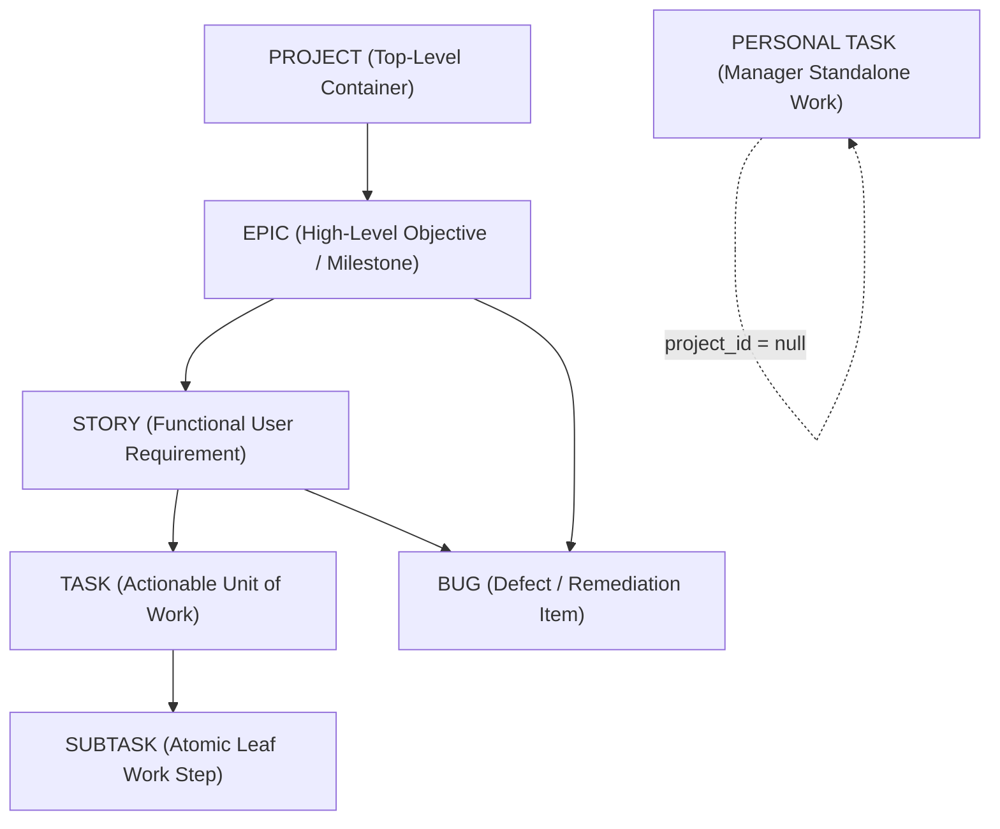

# BUSINESS REQUIREMENTS DOCUMENT (BRD)
## Intern Project Management and Performance Tracking Platform (Intern Hub / PRMS)
**Document Version:** 3.0 — Comprehensive Aligned Specification  
**Baseline Reference:** `BRD_PRMS_v2.1` (Mentor-Review Draft)  
**Status:** Aligned with Codebase Implementation & Database Schema  
**Date:** October 9, 2026  
**Target Audience:** Mentors, Technical Architects, Project Managers, Engineering Leads  

---

## 1. Scope & System Overview

### 1.1 Problem Statement
Organizations operating internship cohorts face operational fragmentation when distributing tasks, monitoring execution, managing timesheets, and tracking evaluation forms across disparate tools (e.g., WhatsApp, Microsoft Teams, email, spreadsheets). This creates blind spots: managers lack centralized visibility into execution blockers and timesheets, while interns suffer from ambiguous work assignments and scattered deadlines.

### 1.2 Proposed Solution
The platform provides a centralized, multi-tenant web platform designed for internship execution, project oversight, and performance tracking. It integrates:
1. Multi-tenant organizational boundaries with dedicated workspace policies.
2. An authentic, Jira-style hierarchical project management system.
3. Automated work-session and timesheet tracking clamped to organizational working hours.
4. Dynamic form creation, distribution, and response tracking.
5. In-app broadcast notifications and activity feeds.
6. Role-specific dashboards for Managers, Tech Leads, Interns, and Super Admins.

### 1.3 Core MVP Scope
- **Multi-Tenant Administration & Provisioning:** Organization provisioning, user creation, CSV bulk import, temporary credential generation, and forced first-time password resets.
- **Strict Jira-Style Work-Item Hierarchy:** Strict parent-child containment (`EPIC` → `STORY` / `BUG` → `TASK` → `SUBTASK`) with leaf invariants.
- **Agile Sprint Workspaces:** Sprint lifecycles (`PLANNED`, `ACTIVE`, `COMPLETED`, `CANCELLED`), single active sprint invariants, story points, burndown tracking, and incomplete task rollover.
- **Synchronized Project Views:** Four interconnected real-time views operating on a unified PostgreSQL source of truth: **Roadmap**, **Sprint Workspace**, **Backlog & Epics**, and **Kanban Board**.
- **Tech Lead Project-Level Operational Workspace:** Scoped management, team progress tracking, work assignment, and reassignment within authorized projects.
- **Work-Session Timers & Timesheets:** Task-level start/stop clocking, automated daily timesheets, lunch break deductions, and timesheet minutes calculated against office policies.
- **Dynamic Form Management:** Schema-driven questionnaire builder (7 input types), publishing workflows, and submission tracking.
- **Multi-Role RBAC:** Separation of platform-level system roles from project-level functional roles.

### 1.4 Future / Out of Scope (Post-MVP)
- Automated AI-driven performance rating algorithms and automated PDF grade card generators (Report cards remain scheduled for V2).
- Third-party chat platform sync (native Teams bot integrations).
- Hardware biometric time clocks (all timesheet logging is purely software-based via task work sessions).

---

## 2. Work Management Hierarchy

The platform implements a strict 4-tier Jira-inspired containment model:

### 2.1 Hierarchy Invariants & Containment Rules
1. **`EPIC`**: Top-level item within a project (`project_id != null`, `parent_id = null`). Only `EPIC` items can reside at the root of a project. Direct children permitted: **`STORY`** and **`BUG`** only.
2. **`STORY`**: Mid-level backlog item. Must have a parent of type `EPIC`. Direct children permitted: **`TASK`** and **`BUG`** only.
3. **`TASK`**: Actionable engineering work item. Must have a parent of type `STORY`. Direct children permitted: **`SUBTASK`** only.
4. **`SUBTASK`**: Atomic execution breakdown. Must have a parent of type `TASK`. **Strict Leaf Item**: Cannot possess any children.
5. **`BUG`**: Defect tracker item. May be created as a direct child of an `EPIC` (project-level defect) or a `STORY` (requirement-level defect). **Strict Leaf Item**: Cannot possess any children.
6. **Manager Personal Tasks**: Standalone task items with `project_id = null` and `parent_id = null`. Must be of type `TASK`. Personal tasks cannot have child items and cannot belong to a project or sprint.

---

## 3. User Roles & Access Architecture

The system decouples **System Roles** (platform-wide authentication and global capabilities) from **Project Roles** (functional responsibility within a specific project team).

### 3.1 System Roles (`Role` & `UserRole`)
- **`SUPER_ADMIN`**: Global platform administrator. Manages multi-tenant organizations and tenant provisioning.
- **`MANAGER`**: Organization-level program manager. Full authority over user provisioning, project creation, cohort oversight, broadcast alerts, and timesheet reports across the tenant.
- **`TECH_LEAD`**: Technical lead with operational authority over explicitly assigned projects. Can assign/reassign work, manage project work items, and track assigned team execution.
- **`INTERN`**: Engineering intern. Executes assigned work, tracks time via work sessions, submits forms, and manages personal Kanban boards.
- **`EMPLOYEE`**: General staff member. Operates under the same operational scope as `INTERN`.
- **`ADMIN`**: Secondary organization administrative role.

### 3.2 Project Roles (`ProjectMember.project_role`)
Assigned on a per-project basis within `project_members`:
1. `TECH_LEAD`: Technical Lead for the project team.
2. `DEVELOPER`: Full-stack or frontend/backend developer.
3. `QA_TESTER`: Quality assurance engineer.
4. `UI_UX_DESIGNER`: Product designer.
5. `DEVOPS_ENGINEER`: Infrastructure and deployment engineer.

---

## 4. Functional Requirements

### 4.1 User & Profile Management
- **FR-UM-01 (Authentication):** The system shall authenticate users via unique email/user codes, issuing short-lived access JWTs and database-backed refresh tokens.
- **FR-UM-02 (User Provisioning):** Managers shall provision individual users and bulk-import users via CSV, auto-generating user codes (`INT-xxx`) and temporary credentials.
- **FR-UM-03 (Forced Password Reset):** Newly provisioned users must be forced to set a permanent password upon first login before accessing portal views.
- **FR-UM-04 (Profile Details):** Users shall view their profile information, batch, subbatch, user code, and update authorized personal details.
- **FR-UM-05 (User Administration):** Managers shall deactivate users and trigger password resets.

### 4.2 Project & Work Management
- **FR-WM-01 (Project Lifecycle):** Managers shall create, update, archive, and delete projects with defined start/end dates and status (`PLANNED`, `ACTIVE`, `COMPLETED`, `ARCHIVED`).
- **FR-WM-02 (Strict Hierarchy Enforcement):** The backend shall enforce the strict hierarchy: `EPIC` → `STORY` / `BUG` → `TASK` → `SUBTASK`, rejecting invalid parent types and cycles.
- **FR-WM-03 (Work Item Attributes):** Work items shall support title, description, type, priority (`LOW`, `MEDIUM`, `HIGH`, `URGENT`), status (`TODO`, `IN_PROGRESS`, `IN_REVIEW`, `COMPLETED`, `BLOCKED`), story points, start date, due date, completed timestamp, and assignees.
- **FR-WM-04 (Assignee Validation):** All work item assignees must be active users in the same organization and confirmed members of the target project.
- **FR-WM-05 (Overdue Detection):** Work items with a past `due_date` and non-`COMPLETED` status shall be dynamically flagged as overdue.
- **FR-WM-06 (Progress Rollup):** Epic progress shall be computed dynamically from direct children ($(\text{completed} / \text{total}) \times 100$), showing $0\%$ when no children exist.
- **FR-WM-07 (Sprint Management):** Projects shall support multiple sprints. Sprints must maintain single active sprint invariants and allow unfinished item rollover upon completion.
- **FR-WM-08 (Synchronized Views):** Roadmap, Sprint Workspace, Backlog & Epics, and Kanban Board shall operate as synchronized views of the same database records.
- **FR-WM-09 (Dedicated Action Items Table):** The system shall persist project meeting action items in a separate dedicated database table (`action_items`), maintaining title, description, assigned project member, creator, due date, status (`OPEN`, `IN_PROGRESS`, `COMPLETED`, `CANCELLED`), and priority (`LOW`, `MEDIUM`, `HIGH`, `URGENT`).

### 4.3 Work Sessions & Timesheets
- **FR-TS-01 (Task Work Clock):** Interns shall start and stop work sessions on assigned tasks, recording start/end timestamps.
- **FR-TS-02 (Timesheet Aggregation):** The system shall aggregate daily work sessions into `time_entries` and compute gross, break, and net minutes.
- **FR-TS-03 (Office Hours Clamping):** Timesheet work session intervals shall be clamped to the organization's work policy window (`09:00` to `17:30`) and deduct scheduled lunch breaks. All time accounting is unified under Timesheets without any separate attendance system.
- **FR-TS-04 (Manager Timesheet Reports):** Managers shall view team-wide timesheet summaries, logged timesheet hours, and unallocated time.

### 4.4 Forms & Submissions
- **FR-FM-01 (Form Builder):** Managers shall create questionnaires with 7 input types (`SHORT_TEXT`, `LONG_TEXT`, `NUMBER`, `SINGLE_SELECT`, `MULTI_SELECT`, `BOOLEAN`, `DATE`), mandatory flags, and deadlines.
- **FR-FM-02 (Form Distribution):** Managers shall publish forms targeted to specific roles (e.g. `INTERN`).
- **FR-FM-03 (Submission Tracking):** The system shall track responses per user, recording timestamps and answers.
- **FR-FM-04 (Response Review):** Managers shall view response tables and export answers per form.

### 4.5 Notifications & Alerts
- **FR-NT-01 (Broadcast Announcements):** Managers and Tech Leads shall dispatch broadcast notifications to all members or selected recipients.
- **FR-NT-02 (In-App Notification Center):** Users shall view real-time notification feeds, unread badges, and mark notifications as read.
- **FR-NT-03 (Asynchronous Queue):** Background notification delivery shall be handled asynchronously via BullMQ and Redis with synchronous fallback.

### 4.6 Dashboards & Reporting
- **FR-RP-01 (Role Dashboards):** The system shall route authenticated users strictly to their authorized dashboard (`/manager/*`, `/tech-lead/*`, `/intern/*`, `/super-admin/*`).
- **FR-RP-02 (Cohort Filter):** Managers shall filter dashboard rosters, projects, and metrics by active cohorts (`Cohort 1`, `Cohort 2`).
- **FR-RP-03 (Live Execution Metrics):** Dashboards shall display real-time counters for active projects, total interns, completed tasks, and overdue items calculated directly from database records.
- **FR-RP-04 (Action Items Workspace):** Project workspaces shall provide an Action Items tab backed by the `action_items` database table for tracking meeting commitments and follow-ups.
- **FR-RP-05 (Tech Lead Dashboard):** The Tech Lead dashboard shall provide two dedicated operational modules:
  1. **Team Performance:** Aggregated project health indicators, sprint burndown velocity, intern task completion distribution, on-time delivery rates, and timesheet hours logged across assigned projects.
  2. **Tasks:** Scoped project task list and Kanban board with status filtering, priority tagging, backlog items, and assignment/reassignment controls.

---

## 5. Section 8.3 — Project Workspaces & Tech Lead Overview

### 5.1 Overview & Architecture
Within project workspaces, operational management is distributed between **Program Managers** and **Technical Leads**. While Managers exercise global organization-level governance, Tech Leads exercise operational execution authority over projects to which they are explicitly assigned.

### 5.2 Tech Lead Dashboard Modules
The Tech Lead dashboard is architected around two core operational capabilities:

1. **Team Performance Module:**
   - **Sprint & Delivery Health:** Real-time visibility into active sprint burndown, velocity trends, and story points completed vs. committed.
   - **Member Workload & Output:** Live breakdown of completed, in-progress, blocked, and overdue work items per intern.
   - **Execution Bottlenecks:** Instant identification of overdue tasks and blocked deliverables.
   - **Timesheet Tracking:** Review of total timesheet hours and active work sessions logged by project members on assigned tasks.

2. **Tasks Module:**
   - **Assigned Projects Work-Item Queue:** Interactive task list and Kanban board displaying all work items (`EPIC`, `STORY`, `TASK`, `SUBTASK`, `BUG`) belonging to projects where the Tech Lead holds membership.
   - **Backlog Refinement & Creation:** Ability to create and refine child work items (`STORY`, `TASK`, `SUBTASK`, `BUG`) within assigned projects.
   - **Assignment & Reassignment:** Authority to assign or reassign tasks among eligible project members to balance load and address bottlenecks.
   - **Status & Priority Progression:** Transitioning tasks across workflow states (`TODO` → `IN_PROGRESS` → `IN_REVIEW` → `COMPLETED` → `BLOCKED`).

### 5.3 Tech Lead Project-Level Operational Capabilities
A Tech Lead shall have operational management capabilities **within the projects explicitly assigned to them in `project_members`**:

1. **Assigned Project Visibility:**
   - View assigned projects, team rosters, and project-level health metrics.
   - Access project Roadmap, Sprint Workspace, Backlog & Epics, Kanban Board, and Action Items.
2. **Team Progress Tracking:**
   - Real-time visibility into total project members and their assigned tasks.
   - Live breakdown of pending, in-progress, blocked, completed, and overdue work items.
   - Tracking member task deadlines, velocity, and story points completed.
   - Review of team member timesheet duration and work session logs within the project context.
   - Objective execution metrics calculated directly from persisted database records without mock data.
3. **Work-Item Management:**
   - Create and refine child work items (`STORY`, `TASK`, `SUBTASK`, `BUG`) within assigned projects.
   - Update task descriptions, priorities, statuses, story points, and deadlines.
   - Create, update, start, and complete sprints within authorized projects.
4. **Assignment and Reassignment Rules:**
   - Assign work items to any eligible active member of the project team.
   - Reassign work items from one eligible project member to another to balance workload or address bottlenecks.
   - **Cross-Project Rejection:** Attempts to assign tasks to users outside the target project or organization shall be rejected with `HTTP 400 Bad Request`.
   - **Hierarchy & Leaf Invariants:** Reassignment operations must strictly preserve parent-child constraints and leaf invariants.
   - All assignment and reassignment operations atomically update `work_item_assignees` in PostgreSQL and synchronize across Roadmap, Backlog, Sprint, and Kanban views.

### 5.4 Manager vs. Tech Lead Operational Boundary

| Functional Area | Manager Capability | Tech Lead Capability |
| :--- | :--- | :--- |
| **Dashboard Focus** | Organization overview, cohort roster, program metrics | **Team Performance** & **Tasks** for assigned projects |
| **Project Access Scope** | All projects in the organization | Strictly projects where Tech Lead is a member |
| **Project Creation & Archival** | Full create, archive, delete authority | Read and operational update only; cannot delete project |
| **Team Membership & Roles** | Add/remove members, assign project roles | Operational assignment of tasks to existing members |
| **Task Assignment & Reassignment** | Any project, any member in organization | Only members of authorized project |
| **Sprint Management** | All projects | Authorized projects |
| **User Administration** | Provision users, bulk import, reset passwords | No user provisioning authority |
| **Broadcast Alerts** | Full organization or arbitrary cohorts | Authorized project team members or general broadcast |
| **Timesheets & Policies** | Configure organization policies & full reports | View project member timesheet work sessions |
| **Action Items** | Create, view, and assign across any project | Create, view, and assign in assigned projects |

---

## 6. Canonical Permission Matrix

This matrix governs authorization across all system and project roles:

| Action / Capability | SUPER_ADMIN | MANAGER | TECH_LEAD | INTERN / EMPLOYEE |
| :--- | :---: | :---: | :---: | :---: |
| **Create / Delete Organizations** | **Yes** | No | No | No |
| **Provision Users & Bulk Import** | No | **Yes** | No | No |
| **Reset Passwords & Deactivate Users** | No | **Yes** | No | No |
| **Create Projects** | No | **Yes** | No | No |
| **View Projects** | No | All Org Projects | Assigned Projects Only | Assigned Projects Only |
| **Update Project Metadata** | No | **Yes** | **Yes** (Assigned) | No |
| **Manage Project Members & Roles** | No | **Yes** | No | No |
| **Create Root Epics in Project** | No | **Yes** | **Yes** (Assigned) | No |
| **Create Stories, Tasks, Bugs** | No | **Yes** | **Yes** (Assigned) | No (Personal only) |
| **Assign / Reassign Project Work** | No | **Yes** | **Yes** (Assigned Members) | No |
| **Update Assigned Task Status / Priority** | No | **Yes** | **Yes** | **Yes** (Assigned Items) |
| **Create / Start / Complete Sprints** | No | **Yes** | **Yes** (Assigned) | No |
| **Delete Sprints** | No | **Yes** | No | No |
| **Manage Project Action Items** | No | **Yes** | **Yes** (Assigned) | Assigned Items Only |
| **Upload Project Documents** | No | **Yes** | **Yes** (Assigned) | No |
| **Start / Stop Task Work Timer** | No | **Yes** | **Yes** | **Yes** |
| **View Team Timesheet Reports** | No | **Yes** (Org-wide) | **Yes** (Project Members) | Personal Only |
| **Configure Work Policy & Office Hours** | No | **Yes** | No | No |
| **Create & Publish Forms** | No | **Yes** | No | No |
| **Submit Form Responses** | No | No | No | **Yes** |
| **Dispatch Broadcast Notifications** | No | **Yes** | **Yes** | No |

---

## 7. Architectural Decisions & Alignments

1. **Tech Lead Dedicated Dashboard:**
   * *Alignment:* Formally established with two dedicated modules: **Team Performance** (live burndown, intern task breakdown, and timesheets) and **Tasks** (work item board/list, backlog refinement, and member assignment).
2. **Unified Timesheet Architecture:**
   * *Alignment:* All time tracking is unified under **Timesheets** backed by `work_sessions` and `time_entries` clamped to organization office hours and lunch breaks. Separate attendance tracking has been completely replaced by timesheet accounting.
3. **Dedicated Action Items Database Table:**
   * *Alignment:* Meeting commitments and follow-ups are persisted in the dedicated `action_items` table with foreign-key links to projects, organizations, assignees, and creators.

