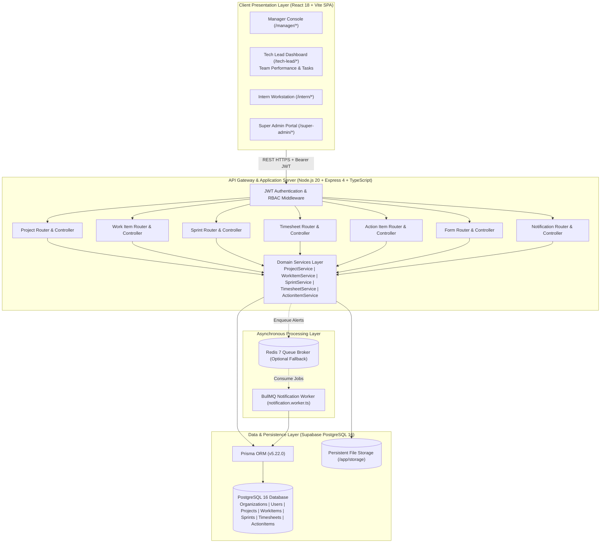
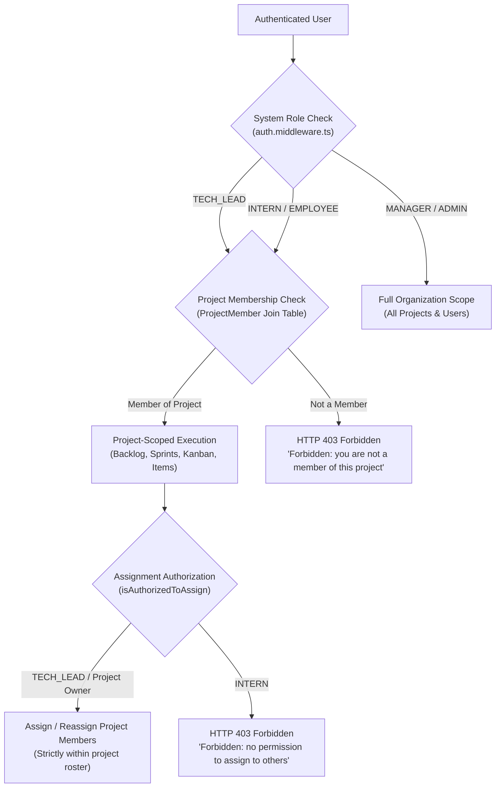
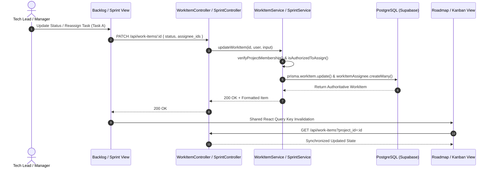

# High-Level Design (HLD) Document
## Intern Hub — Enterprise Project Management & Tracking Platform
**Document Version:** 3.0 — Aligned Architecture & Multi-Role Design  
**Status:** Approved & Verified against Codebase Implementation  
**Date:** October 9, 2026  
**Audience:** System Architects, Engineering Leads, Mentors  

---

## 1. Executive Summary & Architecture Objectives

The **Intern Hub Project Management and Performance Tracking Platform** provides an organization-scoped, multi-tier enterprise workspace for managing student interns, engineering cohorts, technical leads, and program managers.

The architectural foundation guarantees **one single authoritative PostgreSQL database source of truth** across role-specific dashboards and synchronized project views:
1. **Gantt Roadmap:** High-level deliverable milestones and epic progression rollups.
2. **Sprint Workspace:** Active iteration execution, single active sprint invariants, burndown metrics, and incomplete task rollover.
3. **Backlog & Epics:** Jira-style expandable backlog hierarchy, story point estimation, and sprint allocations.
4. **Kanban Board:** Multi-column execution board (`TODO`, `IN_PROGRESS`, `IN_REVIEW`, `COMPLETED`, `BLOCKED`).
5. **Action Items:** Project meeting decisions, commitments, and follow-ups.

### Architectural Invariants:
- **Zero Mock / Synthetic Data:** All counters, health indicators, timesheets, and cards are backed by persistent PostgreSQL tables via Prisma ORM.
- **Strict Jira-Style Hierarchy:** Enforced in database schema and backend domain service (`EPIC` → `STORY` / `BUG` → `TASK` → `SUBTASK`), with leaf invariants for `SUBTASK` and `BUG`.
- **Project-Level Role Scoping:** Centralized authorization ensures Tech Leads and Interns access only projects where they hold explicit membership in `project_members`, while Managers retain tenant-wide oversight.
- **Unified Multi-View Synchronization:** A modification in any view (e.g. Backlog) immediately updates all sibling views (Roadmap, Kanban, Sprint Workspace) through consistent query invalidation.

---

## 2. System Architecture & C4 Context

The application is structured as a decoupled 3-tier enterprise architecture with asynchronous job processing:

### 2.1 Technology Stack & Version Inventory

| Layer | Component | Actual Implementation | Responsibility |
| :--- | :--- | :--- | :--- |
| **Frontend** | Framework | React 18.2, Vite 5.4.21 | Single Page Application with dynamic routing and code splitting |
| | Routing | React Router DOM v6.22 | Role-based protected route wrappers (`ProtectedRoute`) |
| | Styling | Tailwind CSS v3.4.17 | Purple-themed enterprise responsive interface |
| | Iconography | Lucide React | Restrained, accessible SVG icons |
| | HTTP Client | Centralized Fetch / Axios Wrapper | Bearer token injection, automatic refresh handling |
| **Backend** | Runtime | Node.js 20, Express 4.19 | REST API Gateway, routing, request validation |
| | Language | TypeScript 5.4.5 | Static typing, interface definitions, compiler safety |
| | ORM | Prisma ORM 5.22.0 | Schema definition, SQL migrations, relation queries, transactions |
| **Database** | Database Engine | PostgreSQL 16 (Supabase hosted) | Multi-tenant relational persistence, ACID guarantees, foreign keys |
| | Queue & Worker | Redis 7 + BullMQ 5.8 | Background notification dispatch with synchronous DB fallback |
| | Authentication | Dual JWT (Argon2 Hashing) | Short-lived Access Token (15m), Database Refresh Sessions (7d) |

---

## 3. Tech Lead & Role-Based Access Architecture

### 3.1 Authorization Tiers
The system enforces a dual-layered access model:
1. **Tenant-Level System Roles (`UserRole`):** Determines global application privileges (`SUPER_ADMIN`, `MANAGER`, `TECH_LEAD`, `EMPLOYEE`, `INTERN`).
2. **Project-Level Membership Roles (`ProjectMember.project_role`):** Determines functional responsibilities within a project (`DEVELOPER`, `QA_TESTER`, `TECH_LEAD`, `UI_UX_DESIGNER`, `DEVOPS_ENGINEER`).

### 3.2 Tech Lead Dashboard Architecture
The Tech Lead dashboard is split into two primary operational modules:

1. **Team Performance View:**
   - **Sprint Velocity & Burndown:** Real-time calculation of story points completed vs. estimated.
   - **Task Delivery Metrics:** Completed, in-progress, blocked, and overdue items per assigned intern.
   - **Timesheet Hours:** Aggregated daily work sessions and net logged hours by project members.
   - **Bottleneck Detection:** Visual alerts for overdue work items and critical bugs blocking deliverables.

2. **Tasks View:**
   - **Project Work-Item Board & List:** View all work items for assigned projects (`EPIC`, `STORY`, `TASK`, `SUBTASK`, `BUG`).
   - **Lifecycle Management:** Move tasks across workflow states (`TODO`, `IN_PROGRESS`, `IN_REVIEW`, `COMPLETED`, `BLOCKED`).
   - **Assignment & Reassignment:** Dynamically allocate tasks among verified project members with atomic database updates.
   - **Backlog & Sprints:** Refine child items and orchestrate sprint progression.

### 3.3 Tech Lead Project-Level Operational Boundary
- **Scoped Operational Governance:** Tech Leads possess operational authority (create/update work items, start/complete sprints, assign/reassign tasks) solely within projects where they are registered in `project_members`.
- **Backend Isolation Guarantee:** Attempting to view or manipulate work items in a project where the Tech Lead is not an authorized member is intercepted by `work-item.service.ts` (`verifyProjectMembership`) and rejected with `HTTP 403 Forbidden`.
- **Roster-Constrained Assignments:** Tech Leads may only assign or reassign work items to active organization users who are confirmed members of that specific project. Cross-project assignments are rejected with `HTTP 400 Bad Request`.

---

## 4. Multi-View Synchronization Contract

The platform connects four distinct views to the single underlying database entity:

---

## 5. Canonical Permission Matrix

This authoritative matrix applies across the entire system:

| Action / Capability | SUPER_ADMIN | MANAGER | TECH_LEAD | INTERN / EMPLOYEE |
| :--- | :---: | :---: | :---: | :---: |
| **Tenant Provisioning & Management** | **Yes** | No | No | No |
| **Organization User Provisioning & CSV Import** | No | **Yes** | No | No |
| **User Deactivation & Password Reset** | No | **Yes** | No | No |
| **Create New Projects** | No | **Yes** | No | No |
| **View Projects** | No | All Org Projects | Assigned Projects Only | Assigned Projects Only |
| **Update Project Details & Dates** | No | **Yes** | **Yes** (Assigned) | No |
| **Manage Project Members & Role Tags** | No | **Yes** | No | No |
| **Create Project Root Epics** | No | **Yes** | **Yes** (Assigned) | No |
| **Create Stories, Tasks, Bugs** | No | **Yes** | **Yes** (Assigned) | No (Personal only) |
| **Assign & Reassign Project Work** | No | **Yes** | **Yes** (Assigned Members) | No |
| **Update Task Status, Priority, Due Date** | No | **Yes** | **Yes** (Assigned) | **Yes** (Assigned Tasks) |
| **Create, Start, Complete Sprints** | No | **Yes** | **Yes** (Assigned) | No |
| **Delete Sprints** | No | **Yes** | No | No |
| **Manage Project Action Items** | No | **Yes** | **Yes** (Assigned) | Assigned Items Only |
| **Upload & Delete Project Documents** | No | **Yes** | **Yes** (Assigned) | No |
| **Start / Stop Work Session Timer** | No | **Yes** | **Yes** | **Yes** |
| **View Timesheet Aggregations** | No | **Yes** (All Members) | **Yes** (Project Members) | Personal Only |
| **Configure Office Hours & Work Policy** | No | **Yes** | No | No |
| **Create, Publish, Archive Forms** | No | **Yes** | No | No |
| **Submit Form Responses** | No | No | No | **Yes** |
| **Dispatch Broadcast Alerts** | No | **Yes** | **Yes** | No |
