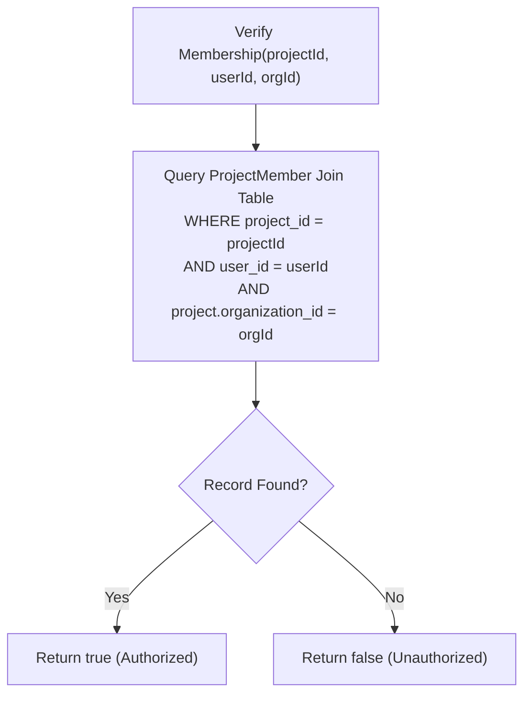

# Low-Level Design (LLD) Document
## Intern Hub — Project Management & Tracking Platform
**Document Version:** 3.0 — Concrete API, Database & Authorization Specification  
**Status:** Approved & Verified against Codebase Implementation  
**Date:** October 9, 2026  
**Audience:** Backend Engineers, Frontend Developers, QA Leads  

---

## 1. Database Schema & Data Models (Prisma ORM)

All models connect to PostgreSQL (hosted on Supabase) via Prisma ORM (`backend-node/prisma/schema.prisma`).

### 1.1 Enumerations
```prisma
enum WorkItemType {
  EPIC
  STORY
  TASK
  SUBTASK
  BUG
}

enum WorkItemStatus {
  TODO
  IN_PROGRESS
  IN_REVIEW
  COMPLETED
  BLOCKED
}

enum WorkItemPriority {
  LOW
  MEDIUM
  HIGH
  URGENT
}

enum SprintStatus {
  PLANNED
  ACTIVE
  COMPLETED
  CANCELLED
}

enum ProjectStatus {
  PLANNED
  ACTIVE
  COMPLETED
  ARCHIVED
}

enum ActionItemStatus {
  OPEN
  IN_PROGRESS
  COMPLETED
  CANCELLED
}

enum ActionItemPriority {
  LOW
  MEDIUM
  HIGH
  URGENT
}
```

### 1.2 Core Data Models

#### `Project` & `ProjectMember`
```prisma
model Project {
  id              String            @id @default(uuid())
  organization_id String
  owner_id        String
  name            String
  description     String?
  start_date      DateTime?
  end_date        DateTime?
  status          ProjectStatus     @default(PLANNED)
  created_at      DateTime          @default(now())
  updated_at      DateTime          @updatedAt

  organization    Organization      @relation(fields: [organization_id], references: [id])
  owner           User              @relation("ProjectOwner", fields: [owner_id], references: [id])
  members         ProjectMember[]
  documents       ProjectDocument[]
  work_items      WorkItem[]
  sprints         Sprint[]
  action_items    ActionItem[]
  forms           Form[]
  time_entries    TimeEntry[]

  @@map("projects")
}

model ProjectMember {
  project_id   String
  user_id      String
  project_role String? // 'DEVELOPER' | 'QA_TESTER' | 'TECH_LEAD' | 'UI_UX_DESIGNER' | 'DEVOPS_ENGINEER'

  project      Project @relation(fields: [project_id], references: [id], onDelete: Cascade)
  user         User    @relation(fields: [user_id], references: [id], onDelete: Cascade)

  @@id([project_id, user_id])
  @@map("project_members")
}
```

#### `WorkItem` & `WorkItemAssignee`
```prisma
model WorkItem {
  id              String             @id @default(uuid())
  organization_id String
  project_id      String?            // Nullable: NULL for manager personal tasks
  sprint_id       String?            // Nullable: Backlog items have sprint_id = null
  parent_id       String?            // Nullable: Top-level root items have parent_id = null
  created_by      String
  type            WorkItemType
  title           String
  description     String?
  status          WorkItemStatus     @default(TODO)
  priority        WorkItemPriority   @default(MEDIUM)
  start_date      DateTime?
  due_date        DateTime?
  story_points    Int?               @default(0)
  completed_at    DateTime?
  created_at      DateTime           @default(now())
  updated_at      DateTime           @updatedAt

  organization    Organization       @relation(fields: [organization_id], references: [id])
  project         Project?           @relation(fields: [project_id], references: [id], onDelete: Cascade)
  sprint          Sprint?            @relation(fields: [sprint_id], references: [id], onDelete: SetNull)
  parent          WorkItem?          @relation("WorkItemHierarchy", fields: [parent_id], references: [id], onDelete: Restrict)
  children        WorkItem[]         @relation("WorkItemHierarchy")
  creator         User               @relation("WorkItemCreator", fields: [created_by], references: [id])
  assignees       WorkItemAssignee[]
  attachments     WorkItemAttachment[]
  time_entries    TimeEntry[]
  work_sessions   WorkSession[]

  @@index([organization_id])
  @@index([project_id])
  @@index([sprint_id])
  @@index([created_by])
  @@index([parent_id])
  @@map("work_items")
}

model WorkItemAssignee {
  work_item_id String
  user_id      String
  created_at   DateTime @default(now())

  work_item    WorkItem @relation(fields: [work_item_id], references: [id], onDelete: Cascade)
  user         User     @relation(fields: [user_id], references: [id], onDelete: Cascade)

  @@id([work_item_id, user_id])
  @@map("work_item_assignees")
}

#### `ActionItem` (Dedicated Meeting & Execution Commitment Table)
```prisma
model ActionItem {
  id              String             @id @default(uuid())
  organization_id String
  project_id      String
  title           String
  description     String?
  assignee_id     String?
  creator_id      String
  due_date        DateTime?
  status          ActionItemStatus   @default(OPEN)
  priority        ActionItemPriority @default(MEDIUM)
  created_at      DateTime           @default(now())
  updated_at      DateTime           @updatedAt

  organization    Organization       @relation(fields: [organization_id], references: [id], onDelete: Cascade)
  project         Project            @relation(fields: [project_id], references: [id], onDelete: Cascade)
  assignee        User?              @relation("ActionItemAssignee", fields: [assignee_id], references: [id], onDelete: SetNull)
  creator         User               @relation("ActionItemCreator", fields: [creator_id], references: [id], onDelete: Cascade)

  @@index([organization_id])
  @@index([project_id])
  @@index([assignee_id])
  @@index([creator_id])
  @@map("action_items")
}
```
```

---

## 2. Backend Service Interfaces & Method Contracts

### 2.1 `WorkItemService` (`src/services/work-item.service.ts`)

```typescript
export class WorkItemService {
  // Authorization & Membership Verification
  static async verifyProjectMembership(projectId: string, userId: string, orgId: string): Promise<boolean>;
  static isAuthorizedToAssign(user: any, projectOwnerId?: string | null, creatorId?: string | null): boolean;

  // Hierarchy Integrity Validation
  static async validateHierarchy(type: WorkItemType, parentId: string | null | undefined, projectId: string | null | undefined, orgId: string): Promise<void>;
  static async assertNoCycles(itemId: string, candidateParentId: string): Promise<void>;

  // Core Operations
  static async createWorkItem(user: any, data: CreateWorkItemInput): Promise<FormattedWorkItem>;
  static async listWorkItems(user: any, filters?: WorkItemFilter): Promise<FormattedWorkItem[]>;
  static async getWorkItemById(id: string, user: any): Promise<FormattedWorkItem>;
  static async updateWorkItem(id: string, user: any, input: UpdateWorkItemInput): Promise<FormattedWorkItem>;
  static async deleteWorkItem(id: string, user: any): Promise<{ message: string }>;
  
  // Assignee Management
  static async addAssignees(id: string, user: any, userIds: string[]): Promise<FormattedWorkItem>;
  static async removeAssignee(id: string, user: any, targetUserId: string): Promise<{ message: string }>;
}
```

### 2.2 `SprintService` (`src/services/sprint.service.ts`)

```typescript
export class SprintService {
  static async createSprint(projectId: string, data: CreateSprintInput, user: any): Promise<Sprint>;
  static async listSprints(projectId: string, user: any): Promise<SprintWithMetrics[]>;
  static async getSprintById(projectId: string, sprintId: string, user: any): Promise<SprintDetail>;
  static async updateSprint(projectId: string, sprintId: string, data: UpdateSprintInput, user: any): Promise<Sprint>;
  static async startSprint(projectId: string, sprintId: string, user: any): Promise<Sprint>;
  static async completeSprint(projectId: string, sprintId: string, options: CompleteSprintOptions, user: any): Promise<Sprint>;
  static async deleteSprint(projectId: string, sprintId: string, user: any): Promise<{ message: string }>;
}
```

### 2.3 `ActionItemService` (`src/services/action-item.service.ts`)

```typescript
export class ActionItemService {
  static async listActionItems(projectId: string, user: any): Promise<ActionItem[]>;
  static async createActionItem(projectId: string, input: CreateActionItemInput, user: any): Promise<ActionItem>;
  static async updateActionItem(projectId: string, itemId: string, input: UpdateActionItemInput, user: any): Promise<ActionItem>;
  static async deleteActionItem(projectId: string, itemId: string, user: any): Promise<{ message: string }>;
}
```

---

## 3. Authorization & Assignment Algorithms

### 3.1 Project Membership Check Algorithm (`verifyProjectMembership`)


### 3.2 Assignment & Reassignment Authorization Logic (`isAuthorizedToAssign`)
```typescript
private static isAuthorizedToAssign(
  user: any,
  projectOwnerId?: string | null,
  creatorId?: string | null
): boolean {
  // 1. Managers and Admins possess global assignment privileges
  if (this.isManagerOrAdmin(user)) return true;

  // 2. Project Owner or Work Item Creator can assign
  if (projectOwnerId && user.id === projectOwnerId) return true;
  if (creatorId && user.id === creatorId) return true;

  // 3. User holding TECH_LEAD system role can assign
  const roleNames: string[] = [];
  if (user.role) roleNames.push(user.role);
  if (Array.isArray(user.roles)) {
    user.roles.forEach((ur: any) => {
      if (ur.role?.name) roleNames.push(ur.role.name);
      if (ur.name) roleNames.push(ur.name);
    });
  }
  if (roleNames.includes('TECH_LEAD') || roleNames.includes('PROJECT_MANAGER')) {
    return true;
  }

  // 4. User holding explicit TASK_ASSIGN permission can assign
  if (Array.isArray(user.permissions) && user.permissions.includes('TASK_ASSIGN')) {
    return true;
  }

  return false;
}
```

### 3.3 Reassignment Execution Algorithm (Atomic Transaction)
When `PATCH /api/work-items/:id` is invoked with `assignee_ids`:
1. Verify `isAuthorizedToAssign(user, project.owner_id, item.created_by)`. If false, throw `Forbidden (HTTP 403)`.
2. Verify all `assignee_ids` exist and are active in the caller's organization. If not, throw `HTTP 400 Bad Request`.
3. If `project_id != null`, query `ProjectMember` for each assignee ID. If any user is not in the project roster, throw `HTTP 400 Bad Request: User <id> is not a member of project <projectId>`.
4. Atomically delete existing rows in `work_item_assignees` for `work_item_id = id`.
5. Insert new rows in `work_item_assignees` for each ID in `assignee_ids`.
6. Return formatted work item with synchronized assignee array.

---

## 4. REST API Endpoint Specifications

### 4.1 Work Items (`/api/work-items`)

| Method | Endpoint | Authorization | Description |
| :--- | :--- | :--- | :--- |
| `POST` | `/api/work-items` | `authenticate` + Project Member / Mgr | Creates work item obeying strict hierarchy |
| `GET` | `/api/work-items` | `authenticate` + Scoped Filter | Lists items (scoped to caller's project membership) |
| `GET` | `/api/work-items/:id` | `authenticate` + Item Access Check | Fetches detailed item with assignees & time entries |
| `PATCH` | `/api/work-items/:id` | `authenticate` + Item Access Check | Updates item fields, status, priority, or assignees |
| `DELETE` | `/api/work-items/:id` | `authenticate` + Creator / Manager | Deletes item (rejected if children exist) |
| `POST` | `/api/work-items/:id/assignees` | `authenticate` + `isAuthorizedToAssign` | Appends assignees to work item |
| `DELETE` | `/api/work-items/:id/assignees/:userId` | `authenticate` + `isAuthorizedToAssign` | Removes assignee from work item |

### 4.2 Sprints (`/api/projects/:id/sprints`)

| Method | Endpoint | Authorization | Description |
| :--- | :--- | :--- | :--- |
| `GET` | `/api/projects/:id/sprints` | `requirePermission('PROJECT_READ')` | Lists sprints with metrics and story points |
| `POST` | `/api/projects/:id/sprints` | `requirePermission('PROJECT_UPDATE')` | Creates new sprint in `PLANNED` status |
| `POST` | `/api/projects/:id/sprints/:sprintId/start` | `requirePermission('PROJECT_UPDATE')` | Starts sprint (enforces single active invariant) |
| `POST` | `/api/projects/:id/sprints/:sprintId/complete` | `requirePermission('PROJECT_UPDATE')` | Completes sprint with unfinished item rollover |
| `DELETE` | `/api/projects/:id/sprints/:sprintId` | `requirePermission('PROJECT_UPDATE')` | Deletes sprint (returns items to backlog) |

### 4.3 Action Items (`/api/projects/:projectId/action-items`)

| Method | Endpoint | Authorization | Description |
| :--- | :--- | :--- | :--- |
| `GET` | `/api/projects/:projectId/action-items` | `authenticate` + Project Member / Mgr | Lists action items for the project |
| `POST` | `/api/projects/:projectId/action-items` | `authenticate` + Project Member / Mgr | Creates an action item assigned to a project member |
| `PATCH` | `/api/projects/:projectId/action-items/:id` | `authenticate` + Member / Mgr | Updates status, priority, due date, or assignee |
| `DELETE` | `/api/projects/:projectId/action-items/:id` | `authenticate` + Creator / Mgr | Deletes an action item |

### 4.4 Tech Lead Dashboard Endpoints

| Method | Endpoint | Authorization | Description |
| :--- | :--- | :--- | :--- |
| `GET` | `/api/projects/:id/performance` | `authenticate` + Project Member (Lead/Mgr) | Fetches Team Performance: burndown, task completion, workload & timesheet stats |
| `GET` | `/api/work-items?project_id=:id` | `authenticate` + Project Member (Lead/Mgr) | Fetches project tasks for the Tasks module with hierarchical children |
| `PATCH` | `/api/work-items/:id` | `authenticate` + `isAuthorizedToAssign` | Reassigns tasks or transitions workflow states |

---

## 5. Verification & Test Suite

The system includes automated backend test scripts verifying all constraints:

1. **Strict Jira Hierarchy Test (`scripts/verify-strict-hierarchy.ts`):**  
   - 30 automated integration assertions testing root creation, personal tasks, Epic children, Story children, Task children, leaf invariants, cycle detection, and type mutation.
   - Result: **30 / 30 Passed (100%)**.
2. **Tech Lead Authorization Test (`scripts/verify-tech-lead-permissions.ts`):**  
   - 7 automated tests covering:
     1. Tech Lead project item listing in authorized project (Passed).
     2. Rejection of unauthorized project item access (Passed).
     3. Tech Lead assignment to eligible project intern (Passed).
     4. Tech Lead reassignment from one intern to another (Passed).
     5. Rejection of assignment to non-project/foreign-organization user (Passed).
     6. Rejection of assignment attempts by interns (Passed).
     7. Continuous valid operation of manager permissions (Passed).
   - Result: **7 / 7 Passed (100%)**.
3. **Timesheet Engine Test (`scripts/verify-timesheet.ts`):**  
   - Validates clamping to office hours (`09:00`–`17:30`), 60-min lunch deduction, and net minute aggregation.
   - Result: **Passed**.
