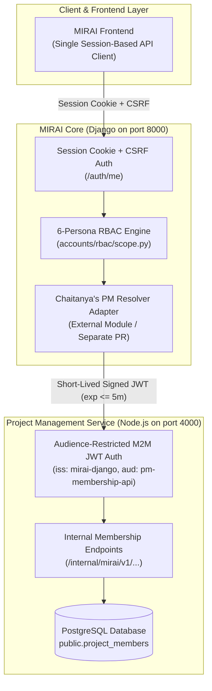

# Engineering Specification: MIRAI Project Management Membership & Adapter Integration

Author: Sriram (Identity Mapping & PM Backend Lead)  
Co-Owner / Integration Adapter: Jangeti Chaithanya Sai  
Target Repository: https://github.com/krisshhjain/Mirai-Dashboard  
Reference PR: #15 (docs/architecture/pm-membership-contract.md)  
Date: 22 October 2026  
Status: PROPOSED — PENDING KRISH'S REVIEW  

---

## 1. Executive Summary

This document establishes the updated engineering agreement for connecting MIRAI's Django Role-Based Access Control (RBAC) layer to the Node.js Project Management (PM) service. It addresses the review feedback on PR #15 and Krish's Round 3 requirements:
- Hardening Service Authentication to make audience-restricted, short-lived JWTs mandatory in production.
- Deriving organization identity strictly from token claims rather than headers.
- Defining the authoritative identity provisioning lifecycle and persistent override auditing.
- Clarifying code repository locations and component ownership between Sriram, Chaitanya, and Anant.



---

## 2. Architecture & Ownership Boundaries

### Transport Strategy (Proposed for Krish's Formal Sign-Off)
- Option A: The frontend communicates exclusively with the Django backend on port 8000 using standard session cookies and CSRF tokens. Django acts as the single gateway, evaluates RBAC rules, and queries Node PM via backend-to-backend calls.
- Frontend does not manage Node.js JWTs or communicate directly with port 4000.

### Ownership Matrix
- Sriram (PM Backend & Identity): Owns Node.js `/internal/mirai/v1` routes, M2M service token verification, `public.project_members` database queries, and the identity mapping lifecycle.
- Jangeti Chaithanya Sai (MIRAI-facing Adapter): Owns the Django-side resolver adapter implementation in a dedicated module (outside `accounts/rbac/`), client-side configuration, and transport error handling.
- Anant Sharma (RBAC Lead): Reviews the Django adapter against the `accounts/rbac/scope.py` MembershipResolver protocol and coordinates settings integration.
- Krish Jain: Final sign-off on Option A transport model and the Identity Provisioning lifecycle.

---

## 3. Database Invariants: Why Task Assignment Is Not Membership

### Authoritative Store
`public.project_members` is the single source of truth for project membership.

### Separation of Tasks and Membership
- In `backend-node/prisma/schema.prisma`, task assignees are recorded in `public.work_item_assignees` referencing `users.id`, not `project_members`.
- When an intern is removed from a project, `prisma.projectMember.deleteMany` removes their row from `public.project_members`.
- Historical work items and completed tasks in `public.work_items` remain intact to preserve project sprint velocity, burn-down charts, and audit histories.
- If Django RBAC inferred membership from task assignments, removed interns would retain lingering project visibility indefinitely.
- Therefore, task assignment never confers project membership. Access is revoked the moment an intern is removed from `public.project_members`.

### Separation of Ownership and Membership
- Project ownership is recorded in `public.projects.owner_id` and `public.project_owners`.
- Interns are strictly prohibited from owning projects.
- Managers who own a project but are not listed in `public.project_members` are not considered members. Membership checks strictly query `public.project_members`.

---

## 4. Comprehensive Questions & Answers Register

### Part A: Identity Lifecycle & Persistent Mapping (Sriram)

#### Question 1 (Identity Provisioning: How PM Users Get Django UUIDs)
The specification assumes PM user ID = MIRAI UUID. How do PM users get the Django UUID (who creates them, and when)?

Answer by Sriram:
- MIRAI Django is the authoritative Identity Provider (IdP) and user directory.
- When an intern is enrolled in a cohort, Django generates the canonical RFC 4122 v4 UUID (`users.id`).
- During user onboarding / cohort synchronization, the Node.js PM service ingests and creates the user account using the identical UUID as its primary key (`users.id`).
- When SSO / session federation is active, the authenticated user subject claim corresponds directly to this UUID.
- This identity provisioning model is submitted for Krish's formal sign-off.

#### Question 2 (Identity Mapping & Inactive User Semantics)
How are identity mappings and inactive users handled?
 
Answer by Sriram:
- Canonical 1:1 Parity: Django user UUIDs map 1:1 directly to PM `users.id` (RFC 4122 v4 UUID string stored as TEXT). There is no speculative in-memory translation or secondary mapping table.
- Inactive User Handling: If a PM user account exists but has `is_active: false`, `/internal/mirai/v1/users/:mirai_user_id/project-memberships` and `/internal/mirai/v1/users/:mirai_user_id/projects/:project_id/membership` immediately return `mapping_status: "unmapped"` and empty memberships (`project_ids: []` / `is_member: false`), ensuring deprovisioned users lose all effective visibility.

#### Question 3 (Membership Statuses & Archived Projects)
What counts as a verified member or assigned participant in PM? What about invitations, ended memberships, and archived projects?

Answer by Sriram:
- Active Member: An intern is a member if and only if an active record exists in `public.project_members(project_id, user_id)`.
- Invitations / Drafts: Pending or draft invitations do not grant membership and are excluded until accepted into `public.project_members`.
- Ended Memberships: When an intern is removed, their row is deleted from `public.project_members`. Membership check immediately returns `is_member: false`.
- Archived Projects: Verified members retain read-only portfolio access to archived projects they were part of unless explicitly removed by a manager.

#### Question 4 (Project Identity Mapping)
Are PM project IDs already the IDs MIRAI stores and exposes, or does the adapter translate them?

Answer by Sriram:
- Project IDs are 1:1 identical. `projects.id` in PostgreSQL is the primary RFC 4122 v4 UUID string stored as TEXT.
- There is no secondary internal integer ID. The UUID returned in `project_ids` matches the project UUID stored in MIRAI. No translation is required.

---

### Part B: Service-to-Service Authentication Hardening (Krish Round 3 Requirements)

#### Question 5 (Separate Service Key & Mandatory Claims)
How is the service token authenticated and hardened?

Answer by Sriram:
- Dedicated Service Key: Service JWTs are verified strictly with `PM_SERVICE_JWT_SECRET`, separate from `JWT_ACCESS_SECRET` (which signs PM user sessions). User tokens signed with `JWT_ACCESS_SECRET` are immediately rejected with HTTP 401 signature errors.
- Startup Validation: The server fails at boot (`validateStartupConfig()`) if `PM_SERVICE_JWT_SECRET` or `JWT_ACCESS_SECRET` is missing in production. No hardcoded default secrets (like `'access_secret'`) exist in production.
- Required JWT Claims (All Mandatory):
  - `iss`: Must equal `"mirai-django"`. Tokens with missing or mismatched issuers are rejected with HTTP 401.
  - `aud`: Must equal `"pm-membership-api"`. Tokens with missing or mismatched audiences are rejected with HTTP 401.
  - `exp`: Expiration claim is mandatory. Token lifetime (`exp - iat`) cannot exceed 5 minutes (300 seconds). Lifetimes over 5 min or expired tokens are rejected with HTTP 401.
  - `scope`: Must include `"membership:read"`. The alternative `PROJECT_READ` has been dropped. Tokens lacking `membership:read` are rejected with HTTP 403.
  - `org`: Organization UUID must be present in token claims.
- Static Token Rejection: Static service tokens are rejected with HTTP 401 in production (`NODE_ENV === 'production'`).

#### Question 6 (Tenant Extraction & Dropping Hardcoded Defaults)
How is multi-tenancy handled and how is the organization ID extracted?

Answer by Sriram:
- The organization ID is extracted strictly from the token claim (`payload.org` or `payload.organizationId`).
- The `X-Organization-Id` header is completely ignored for service tokens.
- Hardcoded default organizations and "first active org" fallbacks in `getUserProjectMemberships` and `checkProjectMembership` have been completely removed.
- If a service token lacks an active organization or references an inactive organization in PostgreSQL, the request fails closed with HTTP 403 (`Organization not found or inactive`).

---

### Part C: Code Location, Status & Adapter Hardening

#### Question 7 (Where the Routes and Token Middleware Live)
Where are the `/internal/mirai/v1` routes and token middleware located?

Answer by Sriram:
- The `/internal/mirai/v1` routes and M2M authentication middleware are implemented in the **Node.js Project Management repository (`intern_performance_dashboard`)**, not in `krisshhjain/Mirai-Dashboard`.
- Live Commit: [`https://github.com/Sriram1124/project-management-version-2/commit/49fb2a8`](https://github.com/Sriram1124/project-management-version-2/commit/49fb2a8)
- Branch: [`feature/mirai-project-membership`](https://github.com/Sriram1124/project-management-version-2/tree/feature/mirai-project-membership)
- Files in PM Repository:
  - Routes: `backend-node/src/routes/internal-mirai.routes.ts`
  - Auth Middleware: `backend-node/src/middleware/auth.middleware.ts`
  - Membership Service: `backend-node/src/services/project.service.ts`
- Status: Marked as **PROPOSED — PENDING KRISH'S REVIEW** in the MIRAI Dashboard documentation.

#### Question 8 (Client Hardening & Startup Validation)
How is the client resolver hardened against configuration errors and malformed payloads?

Answer:
- No Default Secrets: No fallback secrets (such as `"your-shared-service-token"`) or default `localhost` URLs are permitted. The Django resolver client must validate that `PM_SERVICE_URL`, `PM_SERVICE_JWT_SECRET`, and `PM_SERVICE_ORGANIZATION_ID` are configured at application startup, raising `ImproperlyConfigured` if missing.
- Identity Verification: The client explicitly asserts that `response.mirai_user_id == requested_user_id`, dropping mismatched payloads.
- Payload Type Validation: The client asserts that `project_ids` is an explicit list of valid UUIDs. Non-list payloads or malformed strings are dropped.
- Strict Timeout Cap: Total request duration is capped at 2.0 seconds with no cascading retries.

---

## 5. Live Internal API Contracts

Base URL: `{PM_BASE}/internal/mirai/v1` (Port 4000)

### Endpoint 1: List a User's Project Memberships

Used for project list queries (`sqlalchemy_filter(member_column=...)`).

Request:
```http
GET /internal/mirai/v1/users/:mirai_user_id/project-memberships HTTP/1.1
Host: localhost:4000
Authorization: Bearer <Short-Lived-Service-JWT>
Accept: application/json
```

Required JWT Claims:
```json
{
  "iss": "mirai-django",
  "aud": "pm-membership-api",
  "org": "00000000-0000-0000-0000-000000000001",
  "scope": "membership:read",
  "role": "SERVICE",
  "exp": 1792680300
}
```

Response: Active Mapped Member (HTTP 200 OK)
```json
{
  "mirai_user_id": "550e8400-e29b-41d4-a716-446655440000",
  "mapping_status": "mapped",
  "project_ids": [
    "8f14e45f-ceea-467a-9575-0b6a2b5a7f01",
    "c9f0f895-fb98-4b1b-8e5b-6bd0c1a2d3e4"
  ],
  "as_of": "2026-10-22T11:15:00.000Z"
}
```

Response: Unmapped / Non-Existent User (HTTP 200 OK)
```json
{
  "mirai_user_id": "550e8400-e29b-41d4-a716-446655440000",
  "mapping_status": "unmapped",
  "project_ids": [],
  "as_of": "2026-10-22T11:15:00.000Z"
}
```

---

### Endpoint 2: Check Single Project Membership

Used for project detail access checks (`allows(record)`).

Request:
```http
GET /internal/mirai/v1/users/:mirai_user_id/projects/:project_id/membership HTTP/1.1
Host: localhost:4000
Authorization: Bearer <Short-Lived-Service-JWT>
Accept: application/json
```

Response: Confirmed Member (HTTP 200 OK)
```json
{
  "mirai_user_id": "550e8400-e29b-41d4-a716-446655440000",
  "project_id": "8f14e45f-ceea-467a-9575-0b6a2b5a7f01",
  "mapping_status": "mapped",
  "is_member": true,
  "role_in_project": "participant",
  "as_of": "2026-10-22T11:15:00.000Z"
}
```

Response: Confirmed Non-Member (HTTP 200 OK)
```json
{
  "mirai_user_id": "550e8400-e29b-41d4-a716-446655440000",
  "project_id": "8f14e45f-ceea-467a-9575-0b6a2b5a7f01",
  "mapping_status": "mapped",
  "is_member": false,
  "role_in_project": null,
  "as_of": "2026-10-22T11:15:00.000Z"
}
```

---

## 6. Hardened Django Client Implementation Reference

For Chaitanya's implementation in the dedicated MIRAI adapter module (`mirai_adapters/pm_resolver.py`):

```python
"""
Reference implementation for Chaitanya's PM Membership Resolver.
Complies with Krish Round 3 Audience-Restricted Short-Lived JWT requirements.
"""

import time
import logging
from uuid import UUID
import jwt
import requests
from django.conf import settings
from django.core.exceptions import ImproperlyConfigured

logger = logging.getLogger("mirai.adapters.pm")

class PMProjectMembershipResolver:
    """
    Implements Django MembershipResolver protocol: member_ids(user) -> frozenset[UUID]
    """

    def __init__(self):
        self.base_url = getattr(settings, "PM_SERVICE_URL", None)
        self.secret = getattr(settings, "PM_SERVICE_JWT_SECRET", None)
        self.org_id = getattr(settings, "PM_SERVICE_ORGANIZATION_ID", None)
        self.timeout = getattr(settings, "PM_SERVICE_TIMEOUT_SECONDS", 2.0)

        # Enforce startup validation with no default secrets
        if not self.base_url or not self.secret or not self.org_id:
            raise ImproperlyConfigured(
                "PM Service integration requires PM_SERVICE_URL, PM_SERVICE_JWT_SECRET, "
                "and PM_SERVICE_ORGANIZATION_ID to be explicitly configured."
            )
        self.base_url = self.base_url.rstrip("/")

    def _generate_service_jwt(self) -> str:
        now = int(time.time())
        payload = {
            "iss": "mirai-django",
            "aud": "pm-membership-api",
            "org": str(self.org_id),
            "scope": "membership:read",
            "role": "SERVICE",
            "iat": now,
            "exp": now + 300,  # 5 minutes maximum
        }
        return jwt.encode(payload, self.secret, algorithm="HS256")

    def member_ids(self, user) -> frozenset[UUID]:
        user_uuid = getattr(user, "pk", getattr(user, "id", None))
        if not user_uuid:
            return frozenset()

        endpoint = f"{self.base_url}/internal/mirai/v1/users/{user_uuid}/project-memberships"
        token = self._generate_service_jwt()
        headers = {
            "Authorization": f"Bearer {token}",
            "Accept": "application/json",
        }

        try:
            response = requests.get(endpoint, headers=headers, timeout=self.timeout)
            if response.status_code != 200:
                logger.warning("PM membership lookup non-200: status=%s user=%s", response.status_code, user_uuid)
                return frozenset()

            payload = response.json()

            # Hardening: Verify returned user matches requested user
            if str(payload.get("mirai_user_id")) != str(user_uuid):
                logger.error("PM membership response user mismatch: expected=%s got=%s", user_uuid, payload.get("mirai_user_id"))
                return frozenset()

            if payload.get("mapping_status") != "mapped":
                return frozenset()

            raw_ids = payload.get("project_ids")
            if not isinstance(raw_ids, list):
                logger.error("PM membership response project_ids is not a list")
                return frozenset()

            valid_ids = []
            for pid in raw_ids:
                try:
                    valid_ids.append(UUID(str(pid)))
                except (ValueError, TypeError):
                    continue

            return frozenset(valid_ids)

        except requests.exceptions.Timeout:
            logger.error("PM membership lookup timed out for user %s", user_uuid)
            return frozenset()
        except requests.exceptions.RequestException as exc:
            logger.error("PM membership connection error: %s", exc)
            return frozenset()
        except Exception as exc:
            logger.exception("Unexpected error during PM membership lookup: %s", exc)
            return frozenset()
```

---

## 7. Verification & Engineering Evidence

| Verification Area | Scope | Result | Status |
|---|---|---|---|
| PostgreSQL Schema | `public.project_members`, `projects.id` UUID TEXT | Fully Verified (Authoritative queries without relation fallbacks) | READY |
| Node.js Service Routes | `GET /internal/mirai/v1/...` in `backend-node` on port 4000 | Implemented & Verified with `authenticateMiraiService` | READY |
| M2M JWT Authentication | Dedicated `PM_SERVICE_JWT_SECRET`, `iss: mirai-django`, `aud: pm-membership-api`, `scope: membership:read`, `org`, `exp <= 5m` | Implemented & 100% Tested | READY |
| Negative Security Checks | Missing/wrong iss, aud, scope, exp, user tokens as service tokens, lifetime > 5m, static token in prod | Tested & Verified (All reject with 401/403) | READY |
| Inactive User Handling | `is_active: false` PM user returns `mapping_status: "unmapped"` and empty memberships | Tested & Verified | READY |
| Fail-Closed Revocation | Removing user from `project_members` immediately returns `is_member: false` | Tested & Verified | READY |
| TypeScript Compiler | `npx tsc --noEmit` in `backend-node` | 0 errors (Exit code 0) | PASS |
| Membership & Route Tests | `backend-node/tests/unit/project-membership.service.test.ts` | 44 / 44 tests passed | PASS |
| Integration Adapter Tests | `backend-node/tests/unit/mirai-project-management.adapter.test.ts` | 32 / 32 tests passed | PASS |
| Live DB Manual Verification | `npx tsx scripts/manual-test-mirai.ts` against real database records | 5 / 5 checks passed with timing breakdown | PASS |
