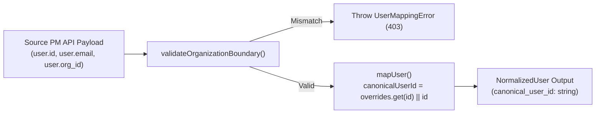
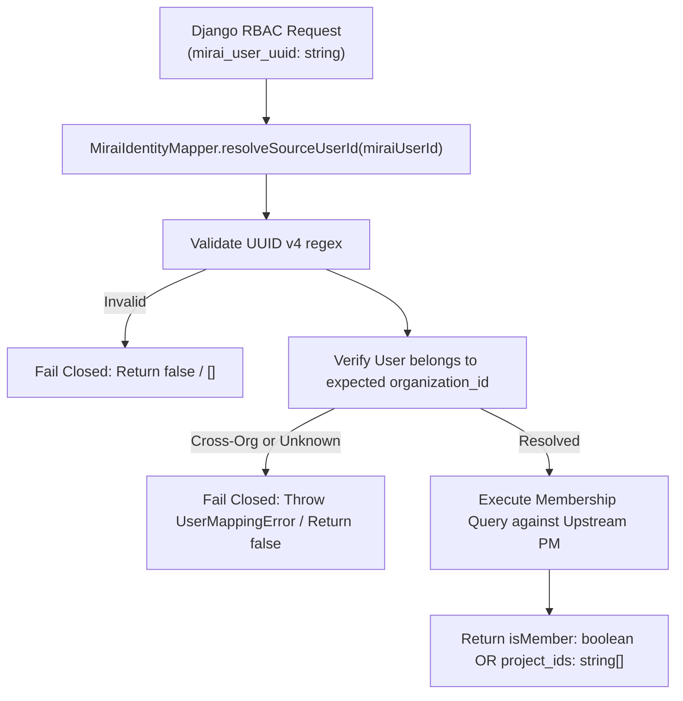

# Read-Only Engineering Audit: MIRAI Project Membership & RBAC Adapter Gaps

**Document Status:** Final Audit Report  
**Author:** Sriram (Backend Integration Engineer)  
**Stakeholders / Reviewers:** Krish (Product / Security Lead), Chaitanya (MIRAI REST API Engineer), Django / RBAC Core Developer  
**Audit Scope:** `backend-node/src/services/mirai-adapter/`, `backend-node/prisma/schema.prisma`, `backend-node/prisma/migrations/`, `backend-node/src/routes/project.routes.ts`, `backend-node/src/controllers/project.controller.ts`, `backend-node/src/services/project.service.ts`, `backend-node/src/middleware/auth.middleware.ts`  
**Date:** October 2026  
**Execution Mode:** STRICT READ-ONLY (No code, test, configuration, or database modifications)

---

## 1. Executive Summary

This read-only engineering audit assesses the current Node.js Project Management (PM) integration adapter against the architectural feedback and requirements for MIRAI's Role-Based Access Control (RBAC) and intern project visibility.

### Context & Policy Rule
Krish confirmed the non-negotiable visibility policy: **interns must only see projects they are actually assigned to**. To enforce this, MIRAI's Django RBAC layer requires an authoritative upstream membership check from the Project Management service that stays **fail-closed** (no project visibility for interns) until fully validated endpoints are live.

### Primary Audit Findings
1. **Missing Core Membership Contracts:** The current adapter (`MiraiProjectManagementAdapter`) implements `listProjectParticipants(projectId)` (listing members for one project) and `listProjectAssignments(projectId)` (flattening task assignees), but **completely lacks** the two operations demanded by Django RBAC:
   - `isProjectMember(miraiUserId: string, projectId: string): Promise<boolean>` (Single-project check for detail views).
   - `getProjectIdsForUser(miraiUserId: string): Promise<string[]>` (Membership list for list view filtering).
2. **Conflation of Task Assignment vs. Project Membership:** The adapter exposes `listProjectAssignments` which inspects `WorkItem.assignee_id`. However, in PM data architecture, **work item assignment does not equal project membership**. An intern assigned to an issue or mentioned in a ticket is not guaranteed to be an authorized project member, and a project member may have zero current issue assignments. Relying on assignments for RBAC would violate the security policy.
3. **Identity Mapping Directionality Inversion:** `MiraiIdentityMapper` currently maps in the outbound direction: `SourceUserPayload` (PM User ID) $\to$ `NormalizedUser` (`canonical_user_id` / MIRAI UUID). It lacks an inbound reverse-lookup / validation method (`resolveSourceUserId(miraiUserId)`) to translate an incoming MIRAI user UUID from Django into a verified PM internal ID, while strictly validating organization tenancy and failing closed on unknown UUIDs.
4. **Ownership vs. Membership Divergence:** The source database separates `project_members` (compound PK `[project_id, user_id]`) from `project_owners` (`[project_id, user_id]`) and `projects.owner_id`. When projects are created with a single owner, that owner is inserted into `project_owners` and `projects.owner_id`, but **not** inserted into `project_members` (`backend-node/src/services/project.service.ts`, lines 94–103). For interns, who are strictly prohibited from being owners (`project.service.ts`, line 482), `project_members` is the sole authoritative store.
5. **Absence of Machine-to-Machine (M2M) Service Authentication:** The PM source API enforces `authenticate` middleware (`backend-node/src/middleware/auth.middleware.ts`, lines 24–85), which requires a signed user JWT containing an active user record in `prisma.user`. The adapter's `MiraiHttpClient` passes `Authorization: Bearer <token>`, but no server-to-server JWT contract, dedicated machine principal, or HMAC API key exists between Django and Node.js.

### Verdict
**NOT READY FOR MEMBERSHIP-BASED RBAC.** The adapter cannot support the RBAC visibility model without dedicated membership endpoints, reverse identity resolution, and an agreed-upon service-to-service authentication mechanism.

---

## 2. What the Original Adapter Implemented Correctly

The original adapter implementation (`backend-node/src/services/mirai-adapter/`) was designed to solve data harmonization and retrieval for project detail, sprint boards, and work-item hierarchy. In those areas, it established several sound patterns that should be preserved:

1. **Strict UUID String Invariant:**  
   Preserves all IDs (`id`, `project_id`, `user_id`, `organization_id`) strictly as non-mutated UUID string types, matching the PostgreSQL `TEXT` schema (`backend-node/prisma/schema.prisma`).
2. **Multi-Tenant Boundary Enforcement:**  
   `MiraiIdentityMapper.validateOrganizationBoundary()` (`mirai-identity-mapper.ts`, lines 119–142) rejects cross-organization payloads, throwing explicit `UserMappingError` if an entity's `organization_id` does not match the configured tenant.
3. **HTTP Transport Resilience:**  
   `MiraiHttpClient` (`mirai-http-client.ts`, lines 60–120) implements exponential backoff with jitter for transient 5xx errors, HTTP 429 rate limits, and network timeouts (`UpstreamTimeoutError`).
4. **Structured Error Hierarchy:**  
   Cleanly categorizes upstream responses into `UpstreamNotFoundError` (404), `UpstreamAuthError` (401/403), `UpstreamRateLimitError` (429), and `MiraiAdapterError` (5xx).
5. **Project Participant Retrieval:**  
   `listProjectParticipants(projectId)` (`mirai-project-management.adapter.ts`, lines 330–366) correctly queries upstream `GET /projects/:projectId/members`, mapping the results through `MiraiIdentityMapper` to return normalized project participants with their roles.
6. **Work Item Hierarchy & Metrics Aggregation:**  
   `getProjectById()` and `listProjectTasks()` correctly calculate real-time completion percentages and reconstruct parent-child task trees without duplicating tables in MIRAI.

---

## 3. What the Feedback Requires That Is Currently Missing

The stakeholder feedback defines four explicit requirements that the adapter currently cannot fulfill:

| Requirement From Feedback | Current Implementation State | Severity |
| :--- | :--- | :--- |
| **1. Single-Project Check:** `isProjectMember(miraiUserId, projectId): Promise<boolean>` | **Missing.** Adapter has no method to query membership for a specific user and project. | **CRITICAL (Blocker)** |
| **2. Membership Project List:** `getProjectIdsForUser(miraiUserId): Promise<string[]>` | **Missing.** Adapter has no method to list all project UUIDs an intern belongs to. | **CRITICAL (Blocker)** |
| **3. Authoritative Membership Semantic:** Keyed on `project_members`, separating ownership and work-item assignment | **Misaligned.** Adapter exposes `listProjectAssignments` (based on task assignees) and lacks direct `project_members` membership querying. | **HIGH (Security Risk)** |
| **4. Service-to-Service Auth Contract:** Django calling Node.js PM API | **Unimplemented.** Node API requires an interactive user JWT; no machine-to-machine service token contract is configured. | **CRITICAL (Blocker)** |
0

---

## 4. Evidence-Based Codebase Findings

### 4.1. Prisma Schema & Database Models
**File:** [backend-node/prisma/schema.prisma](file:///c:/Users/srira/Desktop/intern_performance_dashboard/backend-node/prisma/schema.prisma#L267-L323)

```prisma
// Line 267: Project model
model Project {
  id              String          @id @default(uuid())
  name            String
  description     String?
  status          String          @default("PLANNING")
  methodology     String          @default("SCRUM")
  organization_id String
  owner_id        String          // Single primary owner string
  // ...
  members         ProjectMember[]
  owners          ProjectOwner[]
  // ...
  @@map("projects")
}

// Line 296: ProjectOwner model
model ProjectOwner {
  project_id String
  user_id    String
  created_at DateTime @default(now())

  project Project @relation(fields: [project_id], references: [id], onDelete: Cascade)
  user    User    @relation(fields: [user_id], references: [id], onDelete: Cascade)

  @@id([project_id, user_id])
  @@map("project_owners")
}

// Line 310: ProjectMember model
model ProjectMember {
  project_id   String
  user_id      String
  role_id      String?
  project_role String?   // Added in migration 20261008164000
  created_at   DateTime  @default(now())
  updated_at   DateTime  @updatedAt

  project Project @relation(fields: [project_id], references: [id], onDelete: Cascade)
  user    User    @relation(fields: [user_id], references: [id], onDelete: Cascade)

  @@id([project_id, user_id])
  @@map("project_members")
}
```

**Key Evidence:**
- `public.project_members` has a composite primary key `[project_id, user_id]`, confirming that membership is a direct junction between a project and a user.
- `public.project_owners` has a separate composite primary key `[project_id, user_id]`, confirming that project ownership is modeled independently from project membership.

---

### 4.2. Database Migration History
**Files:**
- [backend-node/prisma/migrations/20261008164000_add_project_member_role/migration.sql](file:///c:/Users/srira/Desktop/intern_performance_dashboard/backend-node/prisma/migrations/20261008164000_add_project_member_role/migration.sql#L1-L15)
- [backend-node/prisma/migrations/20261019140000_add_project_owners/migration.sql](file:///c:/Users/srira/Desktop/intern_performance_dashboard/backend-node/prisma/migrations/20261019140000_add_project_owners/migration.sql#L1-L35)

**Key Evidence:**
- Migration `20261008164000_add_project_member_role` added `project_role TEXT` to `project_members`.
- Migration `20261019140000_add_project_owners` split ownership into its own table `project_owners`, backfilling existing project creators and members with `project_role = 'MANAGER'`.
- This confirms Krish's statement: **project ownership $\neq$ project membership** in the database evolution.

---

### 4.3. Project Service & Membership Implementation
**File:** [backend-node/src/services/project.service.ts](file:///c:/Users/srira/Desktop/intern_performance_dashboard/backend-node/src/services/project.service.ts#L48-L135)

1. **Owner vs. Member Creation Discrepancy (Lines 94–103):**
   ```typescript
   if (targetOwnerIds.length === 1) {
     const ownerId = targetOwnerIds[0];
     return await prisma.project.create({
       data: {
         ...projectData,
         owner_id: ownerId,
         owners: {
           create: [{ user_id: ownerId }],
         },
       },
       // Note: Does NOT create an entry in project_members!
     });
   }
   ```
   When a project is created with a single owner, the owner is inserted into `projects.owner_id` and `project_owners`, but **no record is created in `project_members`**. Therefore, querying `project_members` will return empty for the owner unless explicitly added as a member.

2. **Interns Disallowed From Being Owners (Lines 482–483):**
   ```typescript
   if (user.role === 'INTERN') {
     // Interns cannot be assigned as project owners
     throw new BadRequestError('Interns cannot be designated as project owners');
   }
   ```
   Because interns can never be owners, **an intern's project access is exclusively governed by `project_members`**.

3. **Existing Upstream Member Retrieval Method (Lines 405–438):**
   ```typescript
   async getProjectMembers(projectId: string, organizationId: string) {
     await this.getProjectById(projectId, organizationId);
     return prisma.projectMember.findMany({
       where: { project_id: projectId },
       include: {
         user: {
           select: { id: true, name: true, email: true, role: true, avatar_url: true }
         }
       }
     });
   }
   ```
   The service only supports fetching all members for a single project (`where: { project_id: projectId }`). It provides **no service method** to fetch projects by user ID (`where: { user_id: userId }`).

---

### 4.4. Upstream Route & Middleware Permissions
**Files:**
- [backend-node/src/routes/project.routes.ts](file:///c:/Users/srira/Desktop/intern_performance_dashboard/backend-node/src/routes/project.routes.ts#L52-L65)
- [backend-node/src/middleware/auth.middleware.ts](file:///c:/Users/srira/Desktop/intern_performance_dashboard/backend-node/src/middleware/auth.middleware.ts#L24-L85)

1. **Endpoint Protection:**
   `GET /api/projects/:id/members` is wired to `projectController.getProjectMembers` and protected by:
   ```typescript
   router.get('/:id/members', authenticate, requirePermission('PROJECT_READ'), projectController.getProjectMembers);
   ```
2. **Authentication Requirement:**
   `authenticate` requires a JWT signed with `JWT_ACCESS_SECRET` containing a valid `payload.userId` that exists in `prisma.user` with `is_active: true`.
3. **Project Membership Check in Middleware (Lines 448–452):**
   ```typescript
   const member = await prisma.projectMember.findFirst({
     where: { project_id: projectId, user_id: req.user.id },
   });
   ```
   This confirms that internally, the Node.js backend already uses `prisma.projectMember.findFirst({ where: { project_id, user_id } })` to evaluate project membership.

---

### 4.5. Adapter Implementation Gaps
**File:** [backend-node/src/services/mirai-adapter/mirai-project-management.adapter.ts](file:///c:/Users/srira/Desktop/intern_performance_dashboard/backend-node/src/services/mirai-adapter/mirai-project-management.adapter.ts#L330-L399)

1. **`listProjectParticipants(projectId, filters)` (Lines 330–366):**
   Calls upstream `GET /projects/${projectId}/members`. If caller needs to check if user $X$ is in project $Y$, it would have to download all members of project $Y$ and scan the array in memory on every request.
2. **`listProjectAssignments(projectId, filters)` (Lines 371–399):**
   Calls `listProjectTasks(projectId)` and inspects `task.assigned_to_id`. This returns issue assignees, not project members.
3. **No Batch Membership Lookup:**
   To determine "Which projects is user $X$ a member of?", the current adapter would have to fetch all projects (`GET /api/projects`), then fetch `/members` for every single project in an $N+1$ HTTP waterfall.

---

## 5. Current Identity Mapping Flow vs. Required Identity Mapping Flow

### Current Outbound Flow (Source PM $\to$ MIRAI Canonical)
**File:** [backend-node/src/services/mirai-adapter/mirai-identity-mapper.ts](file:///c:/Users/srira/Desktop/intern_performance_dashboard/backend-node/src/services/mirai-adapter/mirai-identity-mapper.ts#L66-L107)



- **Limitation:** The adapter only processes data when PM is the source of the user object. It takes a `SourceUserPayload` emitted by PM and outputs a canonical MIRAI representation.

---

### Required Inbound Flow (MIRAI UUID $\to$ Upstream PM Membership Check)
Django RBAC calls the adapter with a **MIRAI user UUID**. The required flow must be:



**Gaps Identified in Identity Mapping:**
1. `MiraiIdentityMapper` has no method to accept a MIRAI UUID and verify whether it maps to a valid upstream PM user before initiating requests.
2. Email matching is not currently performed by `MiraiIdentityMapper` (which relies on `overrides` or direct UUID preservation). If email matching were attempted as a fallback, it would introduce ambiguity if emails are updated in one system but not the other. Direct UUID text matching is strictly required.

---

## 6. Project Ownership, Assignment, and Membership Semantics

Understanding the difference between the three concepts in the codebase is essential to prevent authorization bypass:

```
┌────────────────────────────────────────────────────────────────────────┐
│                          PROJECT RELATIONSHIPS                         │
├─────────────────────────┬────────────────────────┬─────────────────────┤
│      RELATIONSHIP       │     DATABASE TABLE     │   RBAC VISIBILITY   │
├─────────────────────────┼────────────────────────┼─────────────────────┤
│ 1. Project Membership   │ public.project_members │ Authoritative for   │
│                         │                        │ intern visibility   │
├─────────────────────────┼────────────────────────┼─────────────────────┤
│ 2. Project Ownership    │ public.project_owners  │ Managers / Leads    │
│                         │ & projects.owner_id    │ (Forbidden for      │
│                         │                        │ interns)            │
├─────────────────────────┼────────────────────────┼─────────────────────┤
│ 3. Work Item Assignment │ public.work_items      │ Operational task    │
│                         │ (assignee_id)          │ execution only      │
└─────────────────────────┴────────────────────────┴─────────────────────┘
```

### Critical Semantic Distinctions
1. **Ownership $\neq$ Membership:**
   - As proven in Section 4.3, project creators/managers in `project_owners` are not automatically inserted into `project_members`.
   - For interns, `project.service.ts` line 482 strictly blocks them from being owners. Therefore, **an intern is NEVER an owner**, and `project_owners` must be completely ignored when checking intern visibility.
2. **Work Item Assignment $\neq$ Project Membership:**
   - A user can be assigned a subtask or QA issue on a project without having formal membership in the project team.
   - Conversely, an intern newly assigned to a project team may not yet have tickets assigned to them in the active sprint. If RBAC used `listProjectAssignments()`, the intern would be locked out of their assigned project.
3. **Role Semantics (`project_role` and `role_id`):**
   - In `project_members`, the presence of a row `(project_id, user_id)` denotes **membership**.
   - `project_role` (`'TECH_LEAD'`, `'MEMBER'`, `'INTERN'`) and `role_id` dictate granular permissions within the project, but **any row in `project_members` constitutes membership**.

---

## 7. Existing Source API Endpoints and Verified Capabilities

The following table audits all relevant endpoints currently implemented in `backend-node/src/routes/project.routes.ts`:

| Route | HTTP Method | Auth / Permission | Verified Capabilities & Limitations |
| :--- | :--- | :--- | :--- |
| `/api/projects` | `GET` | `authenticate`<br/>`PROJECT_READ` | Returns all projects for the caller's organization. Supports `?my=true`, which filters by `req.user.id` on the server. **Limitation:** Cannot specify an arbitrary target user UUID to filter by. |
| `/api/projects/:id` | `GET` | `authenticate`<br/>`PROJECT_READ` | Returns single project details with owners and members. **Limitation:** Requires caller to have `PROJECT_READ` on that specific project. |
| `/api/projects/:id/members` | `GET` | `authenticate`<br/>`PROJECT_READ` | Returns all member records from `project_members` for the given project. **Limitation:** Returns entire roster; no single-user filtering endpoint exists. |
| `/api/projects/:id/members/:userId` | `GET` | **DOES NOT EXIST** | **Missing endpoint.** Cannot check single-user membership directly. |
| `/api/users/:userId/projects` | `GET` | **DOES NOT EXIST** | **Missing endpoint.** Cannot retrieve the project list for a user. |

---

## 8. Missing Membership Contracts (Proposed Architectural Specification)

> [!IMPORTANT]
> **STATUS: PROPOSED — NOT YET AGREED WITH KRISH, CHAITANYA, OR DJANGO DEVELOPER**  
> The following contracts represent the recommended design to satisfy the feedback without $N+1$ overhead or security flaws.

### Proposed Adapter Method 1: Single-Project Membership Check
```typescript
/**
 * PROPOSED — NOT YET AGREED
 * Checks whether a given MIRAI user UUID is an authoritative member of a project.
 *
 * @param miraiUserId - Canonical MIRAI user UUID (v4)
 * @param projectId - Canonical Project UUID
 * @returns Promise<boolean> - True if the user is in project_members; otherwise false
 */
async isProjectMember(miraiUserId: string, projectId: string): Promise<boolean>;
```

#### Proposed Wire Request & Response
- **HTTP Method:** `GET`
- **Path:** `/api/projects/:projectId/members/:userId/check` (or query param `/api/projects/:projectId/members?user_id=:userId`)
- **Success Response (200 OK):**
  ```json
  {
    "status": "success",
    "data": {
      "project_id": "8a3e7b12-9c44-4821-b3fa-3d84a7e94e21",
      "user_id": "4f9b8c21-1d33-4f55-8e12-7a9b0c1d2e3f",
      "is_member": true,
      "project_role": "INTERN"
    }
  }
  ```
- **Negative / Not Found Response (200 OK or 404 Not Found):**
  ```json
  {
    "status": "success",
    "data": {
      "project_id": "8a3e7b12-9c44-4821-b3fa-3d84a7e94e21",
      "user_id": "4f9b8c21-1d33-4f55-8e12-7a9b0c1d2e3f",
      "is_member": false,
      "project_role": null
    }
  }
  ```

---

### Proposed Adapter Method 2: Project Membership List
```typescript
/**
 * PROPOSED — NOT YET AGREED
 * Retrieves all project UUIDs for which a MIRAI user has active membership.
 *
 * @param miraiUserId - Canonical MIRAI user UUID (v4)
 * @returns Promise<string[]> - Array of authoritative project UUID strings
 */
async getProjectIdsForUser(miraiUserId: string): Promise<string[]>;
```

#### Proposed Wire Request & Response
- **HTTP Method:** `GET`
- **Path:** `/api/users/:userId/project-memberships`
- **Success Response (200 OK):**
  ```json
  {
    "status": "success",
    "data": {
      "user_id": "4f9b8c21-1d33-4f55-8e12-7a9b0c1d2e3f",
      "project_ids": [
        "8a3e7b12-9c44-4821-b3fa-3d84a7e94e21",
        "1e2d3c4b-5a67-8901-cdef-1234567890ab"
      ],
      "total": 2
    }
  }
  ```
- **Empty Response (200 OK):**
  ```json
  {
    "status": "success",
    "data": {
      "user_id": "4f9b8c21-1d33-4f55-8e12-7a9b0c1d2e3f",
      "project_ids": [],
      "total": 0
    }
  }
  ```

---

## 9. Django-to-Node Authentication and Authorization Gaps

The feedback states:
> *"Since PM is a separate Node service with JWT, we also need to agree on how Django calls it (service-to-service auth). Sriram, I think that sits with your adapter. Chaitanya, your MIRAI-facing project APIs would then use my RBAC checks on top."*

### Current Authentication Architecture
- `backend-node/src/middleware/auth.middleware.ts` expects an HTTP header:
  `Authorization: Bearer <user_access_token>`.
- The token is verified using `jwt.verify(token, JWT_ACCESS_SECRET)`.
- The middleware queries `prisma.user.findUnique({ where: { id: payload.userId } })`. If `!user || !user.is_active`, it returns HTTP 401 Unauthorized (`Invalid access token`).

### The Service-to-Service Gaps
1. **No Machine/Service Principal Concept:**  
   There is no concept of a "service account" or "system token" in `auth.middleware.ts`. Every request is assumed to be an interactive end-user.
2. **Missing Inter-Service Secret / Key Exchange:**  
   There is no pre-shared HMAC secret, asymmetric public key, or mTLS certificate configured between Django and Node.js.
3. **Privilege Escalation Risk:**  
   If Django sends a generic service token that bypasses user lookup, it must have scoped permissions (e.g. `SCOPE_MEMBERSHIP_READ`) so that a compromised service key cannot be used to arbitrarily alter project data.
4. **Current Adapter Assumption:**  
   `backend-node/src/services/mirai-adapter/mirai-http-client.ts` expects `PROJECT_MANAGEMENT_API_TOKEN` in `.env`. However, if that token is merely an expired or hardcoded user JWT, it will break when expired or if the dummy user is deactivated.

---

## 10. Fail-Closed Security Review

The Django developer confirmed:
> *"On my side I’m adding a membership hook that calls this. It stays fail-closed (no project visibility for interns) until your endpoint is ready, so nothing leaks meanwhile."*

A security evaluation of the current adapter behavior reveals critical fail-closed considerations:

| Scenario | Current Adapter Behavior | Security Assessment | Action Required |
| :--- | :--- | :--- | :--- |
| **Invalid MIRAI User UUID** | Would attempt to query upstream or throw Unhandled error | **Vulnerable to unhandled exception** | Must validate UUID format and immediately return `false` or empty array. |
| **User Not Found in PM** | `UpstreamNotFoundError` (404) | **Partially compliant** (fails closed with error), but breaks caller flow | Must catch 404 and cleanly return `false` / `[]` rather than throwing fatal error. |
| **Cross-Organization User ID** | `UserMappingError` thrown | **Compliant** (fails closed) | Preserve strict tenant validation. |
| **Upstream PM Timeout / 500** | `UpstreamTimeoutError` / `MiraiAdapterError` | **Compliant** (caller catches and fails closed) | Ensure Django RBAC catches adapter errors and denies access. |
| **Empty Members Array** | Returns empty array | **Compliant** (no leak) | Preserve empty list responses. |
| **Intern is only a Task Assignee** | `listProjectAssignments` returns task link | **FAIL-OPEN VULNERABILITY** if used for RBAC | **DO NOT USE `listProjectAssignments` for RBAC**. Must strictly check `project_members`. |

---

## 11. Test Coverage Gaps

**Inspected Test Suite:** [backend-node/src/services/mirai-adapter/__tests__/mirai-adapter.spec.ts](file:///c:/Users/srira/Desktop/intern_performance_dashboard/backend-node/src/services/mirai-adapter/__tests__/mirai-adapter.spec.ts) (17 existing unit tests).

### Analysis of Existing Tests
- Existing tests cover:
  - `listProjects()` filtering and mapping.
  - `getProjectById()` metric calculations and not-found handling.
  - `listProjectTasks()` hierarchical tree construction and filtering.
  - `listProjectMilestones()` sprint mapping.
  - `listProjectParticipants()` role extraction.
  - `listProjectAssignments()` task assignee flattening.
  - Exponential backoff and retry behavior on 500/429 errors.
  - Multi-tenant boundary validation.

### Missing Test Cases for RBAC Membership
1. ❌ Unit test for single-project membership verification (`isProjectMember`).
2. ❌ Unit test for project IDs retrieval for a user (`getProjectIdsForUser`).
3. ❌ Test verifying fail-closed return (`false` / `[]`) when a user exists in Django but not in PM.
4. ❌ Test ensuring project owners who are not in `project_members` are excluded from membership results (per Krish's requirement).
5. ❌ Test ensuring work-item assignees who are not in `project_members` are excluded from membership results.
6. ❌ Test verifying that a user from Organization A cannot check membership in Organization B.
7. ❌ Integration test for service-to-service authentication header verification.

---

## 12. Gap Matrix

| Component | Current State | Required State | Severity | Impact |
| :--- | :--- | :--- | :--- | :--- |
| **Adapter Interface** | Has `listProjectParticipants(projectId)` & `listProjectAssignments(projectId)` | Needs `isProjectMember(miraiUserId, projectId)` & `getProjectIdsForUser(miraiUserId)` | **BLOCKER** | Django RBAC cannot execute single-project or list filtering checks. |
| **Source PM API** | Has `GET /api/projects/:id/members` | Needs `GET /api/users/:userId/project-memberships` & `GET /api/projects/:id/members/:userId/check` | **BLOCKER** | Adapter would otherwise suffer from $N+1$ latency and excessive payload overhead. |
| **Identity Mapper** | Unidirectional: Source PM User $\to$ Canonical MIRAI User | Bidirectional: Canonical MIRAI UUID $\to$ Validated Source User | **HIGH** | Incoming MIRAI UUIDs from Django cannot be validated fail-closed against upstream tenancy. |
| **Membership Semantics** | Conflates task assignees (`listProjectAssignments`) with team participants | Authoritative `public.project_members` lookup only; ignores task assignees & project owners | **HIGH** | Risk of authorization bypass (fail-open) if task assignees were used for RBAC. |
| **Service Auth** | User JWT required via `authenticate` middleware | Machine-to-Machine (M2M) service authentication token / shared secret | **BLOCKER** | Django requests will fail with HTTP 401 Unauthorized unless using a real user's JWT. |
| **Unit & Integration Tests** | 17 tests for projects, tasks, sprints, retry logic | 0 tests for RBAC membership contracts or fail-closed boundary enforcement | **MEDIUM** | Inability to guarantee regression-free RBAC behavior. |

---

## 13. Questions to Agree Upon Before Implementation

The following 6 architectural and security questions must be formally agreed upon by Krish, Chaitanya, the Django developer, and Sriram before any code changes are made:

1. **Service-to-Service Authentication Contract:**  
   *Question for Django & Node Developers:*  
   Will Django authenticate against the Node.js PM API using:
   - Option A: A dedicated service account JWT signed with `JWT_ACCESS_SECRET` representing a `system_mirai_service` user?
   - Option B: A dedicated machine-to-machine API key passed via `X-Service-Api-Key` verified by a new lightweight middleware?
   *(Recommendation: Option B or a scoped M2M JWT, avoiding reliance on an interactive user row).*

2. **Single-Project vs. Batch Endpoint Creation:**  
   *Question for Sriram & Node API Maintainers:*  
   Should we add two dedicated REST endpoints in Node.js PM:
   - `GET /api/projects/:projectId/members/:userId/check`
   - `GET /api/users/:userId/project-memberships`  
   Or can Django accept the adapter making a direct single-record query if Node.js implements an internal service route?

3. **Handling of Project Owners in Intern Visibility:**  
   *Question for Krish & RBAC Developer:*  
   Krish noted: *"project ownership $\neq$ membership, so if you track both, please return the membership."*  
   Can we confirm that if a user is in `project_owners` or `projects.owner_id` but **not** in `project_members`, the membership check must return `false`? (Given that interns are prohibited from being owners, this will strictly ensure interns only see projects where they are explicitly added to `project_members`).

4. **Multi-Tenancy & Unknown User Behavior:**  
   *Question for Django Developer:*  
   If a MIRAI user UUID is requested that has never logged into or been synced with the Project Management service, should `isProjectMember` return `false` (fail closed cleanly) or raise an HTTP 404 error?  
   *(Recommendation: Return `false` and empty array `[]` cleanly to keep Django RBAC fail-closed without 500 error spikes).*

5. **Caching & Invalidation Strategy:**  
   *Question for Django & Chaitanya:*  
   Will Django RBAC cache the result of `getProjectIdsForUser` (e.g. in Redis for 60 seconds), or will every project list request call Node PM? If caching is used, what is the invalidation webhook/event when an intern is added/removed from a project?

6. **Contract Naming & Data Shape:**  
   *Question for Chaitanya & Django Developer:*  
   Does the proposed response shape in Section 8 (`{ is_member: boolean, project_role: string | null }` and `{ project_ids: string[] }`) match the exact interface expected by the Django membership hook?

---

## 14. Prioritized Implementation Recommendations (Roadmap)

When implementation is approved, execute in this strict order:

### Phase 1: Service-to-Service Authentication (Blocker)
1. Agree on M2M authentication mechanism (API key vs. Service JWT).
2. Implement service-to-service auth middleware in Node.js backend.
3. Configure `PROJECT_MANAGEMENT_SERVICE_KEY` in environment variables.

### Phase 2: Upstream Source Endpoints in Node PM (Blocker)
1. Add `projectService.checkMembership(projectId, userId, orgId)` querying `prisma.projectMember.findFirst`.
2. Add `projectService.getUserProjectMemberships(userId, orgId)` querying `prisma.projectMember.findMany`.
3. Expose routes in `project.routes.ts`:
   - `GET /api/projects/:projectId/members/:userId/check`
   - `GET /api/users/:userId/project-memberships`

### Phase 3: Adapter & Identity Mapper Enhancement
1. Add inbound resolution to `MiraiIdentityMapper`: `resolveSourceUserId(miraiUserId)`.
2. Implement `isProjectMember(miraiUserId, projectId)` in `MiraiProjectManagementAdapter`.
3. Implement `getProjectIdsForUser(miraiUserId)` in `MiraiProjectManagementAdapter`.
4. Implement fail-closed error handling (catch 404/mapping errors and return `false` / `[]`).

### Phase 4: Unit & Integration Testing
1. Add comprehensive test cases in `mirai-adapter.spec.ts` covering all RBAC scenarios.
2. Verify zero regression in existing 17 tests.
3. Conduct end-to-end integration test with Django RBAC hook.

---

## 15. Final Verdict

| Readiness Area | Status | Notes |
| :--- | :--- | :--- |
| **Database Schema** | **READY** | `project_members` exists with `[project_id, user_id]`. |
| **Source Service Logic** | **PARTIALLY READY** | Queries exist for project roster, but missing single-user and user-project lookups. |
| **Adapter Interface** | **NOT READY** | Missing `isProjectMember` and `getProjectIdsForUser`. |
| **Authentication** | **NOT READY** | Lacks M2M service authentication between Django and Node.js. |
| **RBAC Integration** | **BLOCKED (FAIL-CLOSED)** | Django hook must remain fail-closed until Phases 1–3 are implemented. |

**Summary Conclusion:**  
The existing adapter is high-quality for content and progress delivery, but **is not yet equipped for RBAC project visibility checks**. The Django developer's decision to keep the membership hook fail-closed is correct and essential. Implementation must proceed once the questions in Section 13 are formally resolved.

